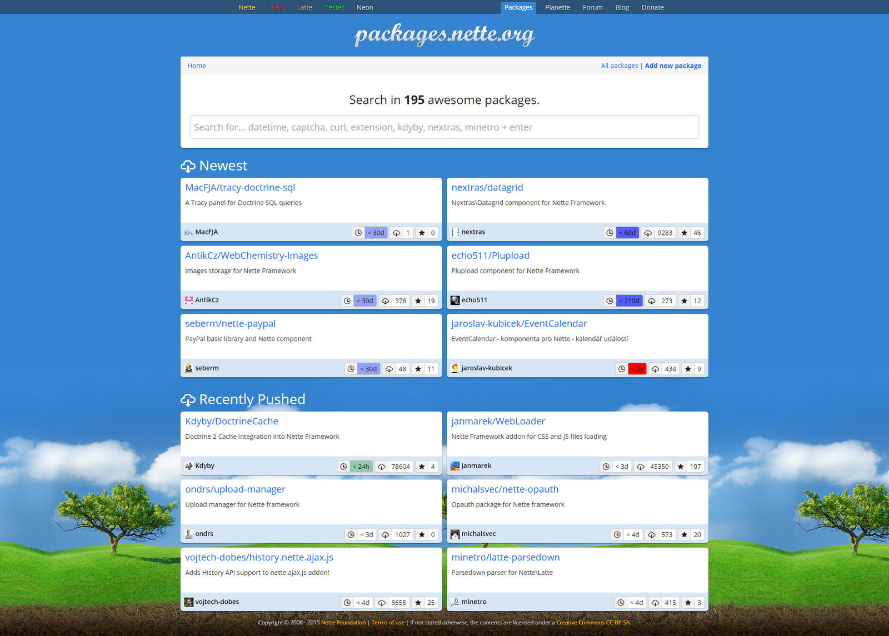
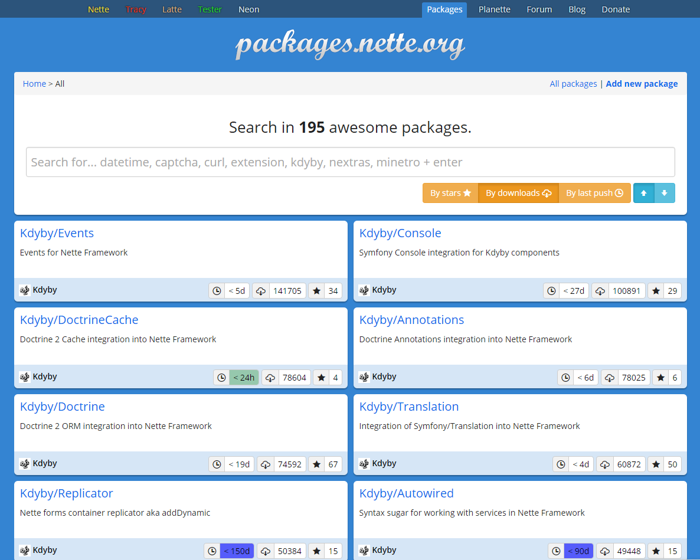
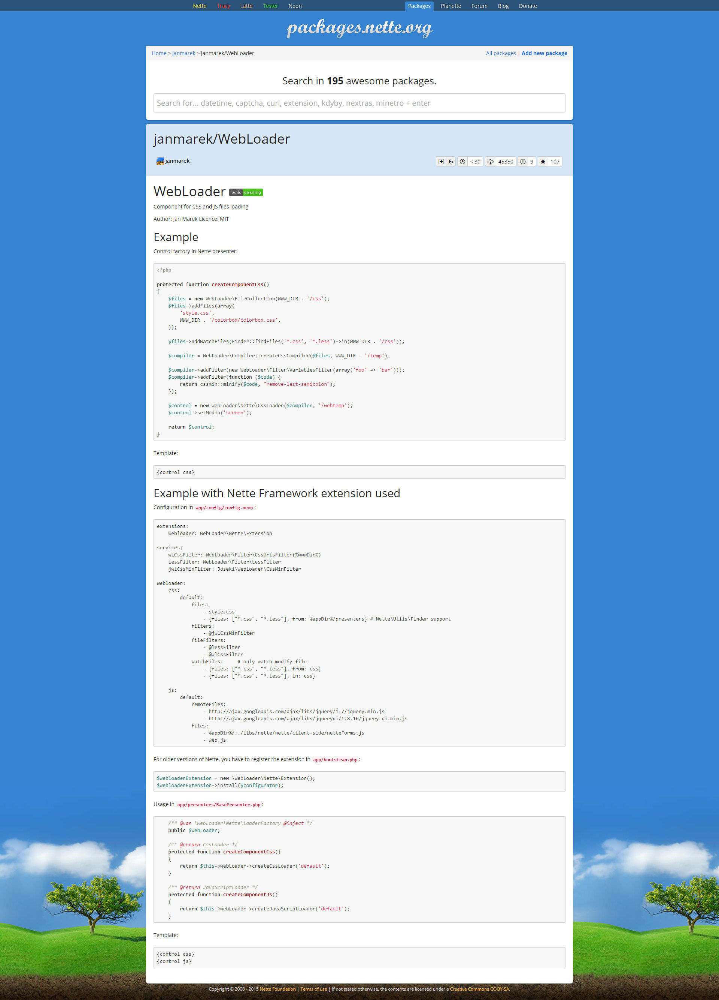
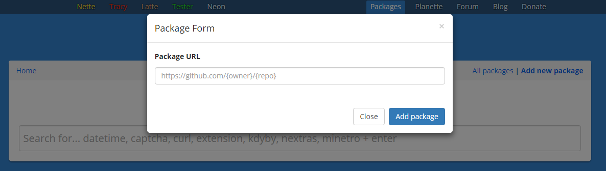

Zkusil jsem se zapojit do Nette komunity vytvořením nového Nette Addons portálu, resp. Nette Packages jak jsem ho nazval.

## Co mi vadilo na starém addons.nette.org

Největší dispozicí pro mě byla manuální aktualizace readme. Rád vyvijím řešení, které pak dam open-source, například balíček takových řešení je [**Minetro**](https://github.com/Minetro). Když člověk vydá nějakou tu verzi, nebo změní readme, musel jsem pak ručně měnit tyto texty u konkretního addonu. To mi přijde jako ztráta času.

Dále vidím jako nepotřebné věci hodnocení, jiné verze addonu, nutnost registrace. Je potřeba pochválit všechny, kteří tomu věnovali svůj čas, ale ja tyto věci skoro nevyužíval.

## Nová koncepce packages.nette.org

Hlavní přednost vidím v nějakém vlastním fungujícím ekosystému. Kdokoli může vložit balíček, který sám vytvořil nebo se mu jenom líbí a omylem na něho narazil. Stačí ho zaevidovat do systému a vše se pak dějě automaticky.

Automaticky se získají data z GitHubu, jako kolik je releasu, kolik je tagu, kolik je hvězdiček, datum posledního commitu apod. Vše by mělo být zobrazeno tak, aby se v tom člověk dobře orientoval a rychle našel co potřebuje.

## Dobré návyky

Jako jednu z předností vídím i rozvíjení dobrých návyku. Je potřeba balíček / rošíření / knihovnu vložit na Github a zaregistrovat jako composer bálíček na packagist.org.

Všechny tyto rozšíření dostanou tak jednotný řád.

## Ukázky

-   Demo: [http://componette.org](http://componette.org/)
-   GitHub: [https://github.com/planette/componette](https://github.com/planette/componette)

