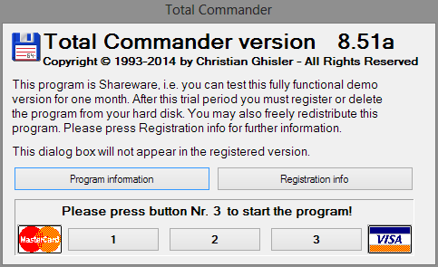
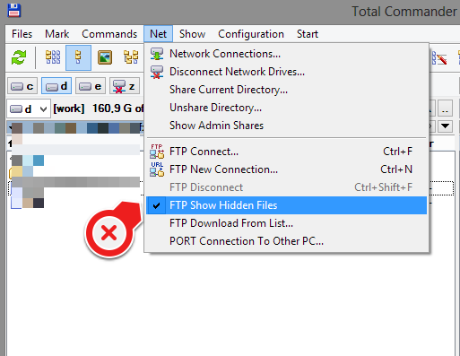

Total Commander je skvělá aplikace, bez které bych se na svém notebooku už neobešel. Využívám ji prakticky denně na FTP přenosy, hromadné přejmenování, rychlou editaci, náhledy souborů a fotek, porovnávání souborů.

## Instalace

TCMD můžete stáhnout z oficiálních stránek. Program je vydáván jako **shareware**, což znamená že základní verze není zdarma. Naštěstí v případě TCMD, vás na začátku bude otravovat malé okno, které lze jednoduše skrýt a program používat.**Vlastnosti a možnosti**

TCMD je mnohoúčelový program, který zastane nejrůznější úlohy a jednoúčelové aplikace.

-   Soubory a složky - základní přehled souborů a složek, jejich řazení, filtrace, podrobné detaily, velikosti, koncovky
-   Vyhledávání - vyhledávání souborů i textů v souborech
-   Hromadné přejmenování - přejmenování více souborů či složek
-   Hromadný výběr - pro kopírování, mazání
-   Synchronizace složek - synchronizace dvou ruzných složek (například server a localhost)
-   Archivace - rozbalování, zabalování
-   FTP - jednoduchý FTP klient
-   Hotkeys - klávesové zkratky (F3-F8)

## Tipy

### Zobrazení skrytých FTP souborů

Soubory jako **.htaccess** apod

Tohle však funguje pouze jednou, po zavření TCMD se nastavení resetuje.

Pro trvalé nastavení je potřeba do souboru **wcx\_ftp.ini** do skupiny **\[General\]** přidat **FtpShowHidden=1**, pak to bude pernamentní.

### Dynamické zobrazování velikostí (souborů a složek)

Místo **48 728b** se zobrazí **47,5kB** apod.

### Rychlé hledání

Pouze pomocí psaní znaků a čísel (bez CTRL nebo SHIFT).

