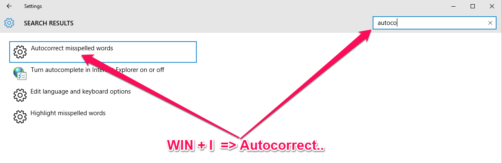
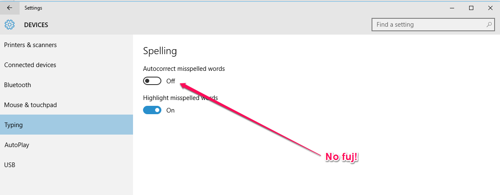
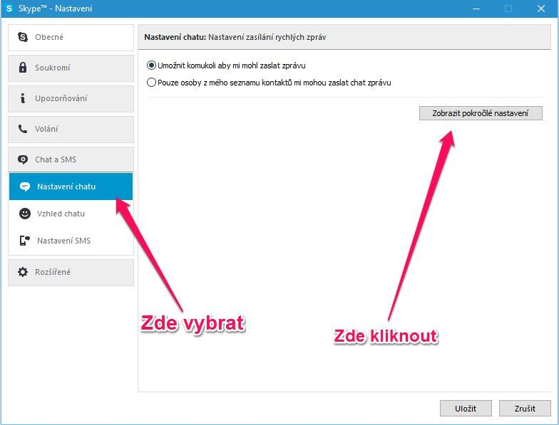
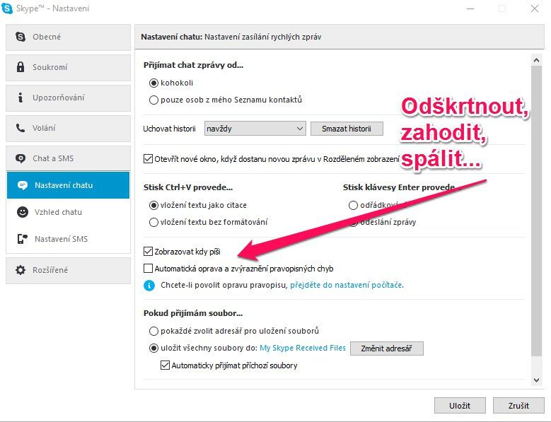
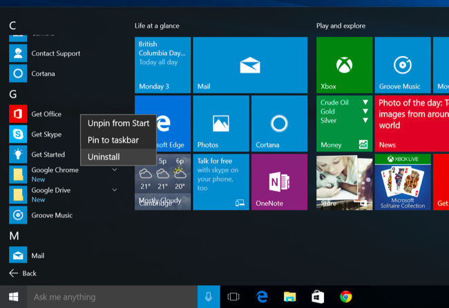
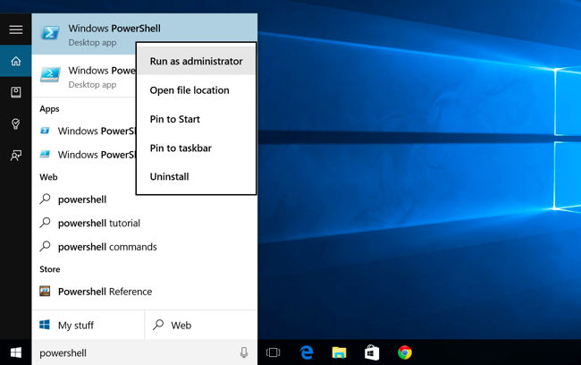
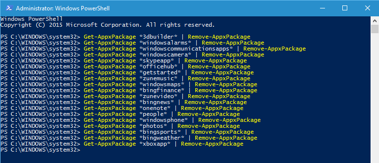

Používáte Windows 10 a otravuje vás autokorekce? Opravuje vám to i Skype? Pak by se vám mohl hodit tento návod.

Windows 10 tu už nějaký ten pátek jsou a musím říct, že se mi dobře používají. Nerad by rozpoutál diskuzi, jestli je lepší ten nebo onen systém pro vývojáře. Ať si každý používá co chce.

Rád bych se podělil o 3 tipy a to:

-   jak zakázat autokorekce ve Windows 10
-   jak zakázat autokorekce ve Skypu
-   jak odebrat build-in aplikace ve Windows 10

## Autokorekce ve Windows 10

Magickou kombinací klávest **WIN** + **I** se vám otevře okno podobné tomuto.

Potom do vyhledávacího pole zadáte "Autocorrection" a vyberete **Autocorrect misspelled words**.

Tam nastavíte **Autocorrect misspelled words** na `OFF` a je to.

Windows vám pak už nebudou opravovat slova. Ocení to hlavně ti, co používají defaultně anglickou klávesnici spolu s anglickým systémem a **občas** chtějí napsat něco s diakritikou.

## Autokorekce ve Skypu

Občas se stáva, že vám skype sem tam něco opraví a vy si toho všimnete až po odeslání. Klasika.

Odstranit tuto vlastnost není nic těžkého, když víte kde hledat.

Zobrazíme si Nastavení -> Nastavení chatu -> Zobrazit pokročilé nastavení.

Zhruba za půlou stránky je zaškrtávátko "Automatická oprava a zvýraznění pravopisných chyb". Stačí odškrnout a máme hotovo.

## Odstranění build-in aplikací

**Click-by-click**

Pro ty co nechtějí zadávat příkazy a raději více klikají je ideální tento postup.

My neklikači radší zvolíme ten další.

**PowerShell**

Nejdříve je potřeba otevřít PowerShell jako administrátor. Stačí zmačknout **WIN** a napsat **PowerS..**, Windows už vám sám našeptá.

Pravým klikem "Run as administrator" a je to.

Dále nás čeká sada příkuzů, neboť těch předinstalovaných aplikací je opravdu hodně. Záleží pak na vás, které si chcete nechat a které ne.

Kompletní přehled může vypadat takto, dále pak jednotlivé příkazy.

-   3D Builder

`Get-AppxPackage *3dbuilder* | Remove-AppxPackage`

-   Alarms and Clock

`Get-AppxPackage *windowsalarms* | Remove-AppxPackage`

-   Calculator

`Get-AppxPackage *windowscalculator* | Remove-AppxPackage`

-   Calendar and Mail

`Get-AppxPackage *windowscommunicationsapps* | Remove-AppxPackage`

-   Camera

`Get-AppxPackage *windowscamera* | Remove-AppxPackage`

-   Contact Support

`Bohužel nelze odebrat`

-   Cortana

`Bohužel nelze odebrat`

-   Get Office

`Get-AppxPackage *officehub* | Remove-AppxPackage`

-   Get Skype

`Get-AppxPackage *skypeapp* | Remove-AppxPackage`

-   Get Started

`Get-AppxPackage *getstarted* | Remove-AppxPackage`

-   Groove Music

`Get-AppxPackage *zunemusic* | Remove-AppxPackage`

-   Maps

`Get-AppxPackage *windowsmaps* | Remove-AppxPackage`

-   Microsoft Edge

`Bohužel nelze odebrat`

-   Microsoft Solitaire Collection

`Get-AppxPackage *solitairecollection* | Remove-AppxPackage`

-   Money

`Get-AppxPackage *bingfinance* | Remove-AppxPackage`

-   Movies & TV

`Get-AppxPackage *zunevideo* | Remove-AppxPackage`

-   News

`Get-AppxPackage *bingnews* | Remove-AppxPackage`

-   OneNote

`Get-AppxPackage *onenote* | Remove-AppxPackage`

-   People

`Get-AppxPackage *people* | Remove-AppxPackage`

-   Phone Companion

`Get-AppxPackage *windowsphone* | Remove-AppxPackage`

-   Photos

`Get-AppxPackage *photos* | Remove-AppxPackage`

-   Store

`Get-AppxPackage *windowsstore* | Remove-AppxPackage`

-   Sports

`Get-AppxPackage *bingsports* | Remove-AppxPackage`

-   Voice Recorder

`Get-AppxPackage *soundrecorder* | Remove-AppxPackage`

-   Weather

`Get-AppxPackage *bingweather* | Remove-AppxPackage`

-   Windows Feedback

`Bohužel nelze odebrat`

-   Xbox

`Get-AppxPackage *xboxapp* | Remove-AppxPackage`

Kompletní seznam převzat z [www.howtogeek.com](http://www.howtogeek.com/224798/how-to-uninstall-windows-10s-built-in-apps-and-how-to-reinstall-them/).

Doufám, že vám to alespoň trochu pomohlo a že jste "ulevili" vašemu systému.
