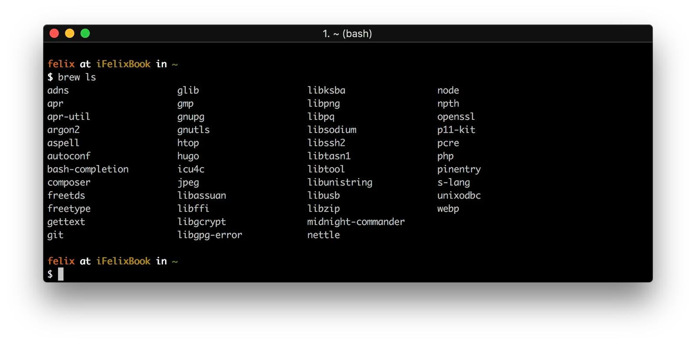
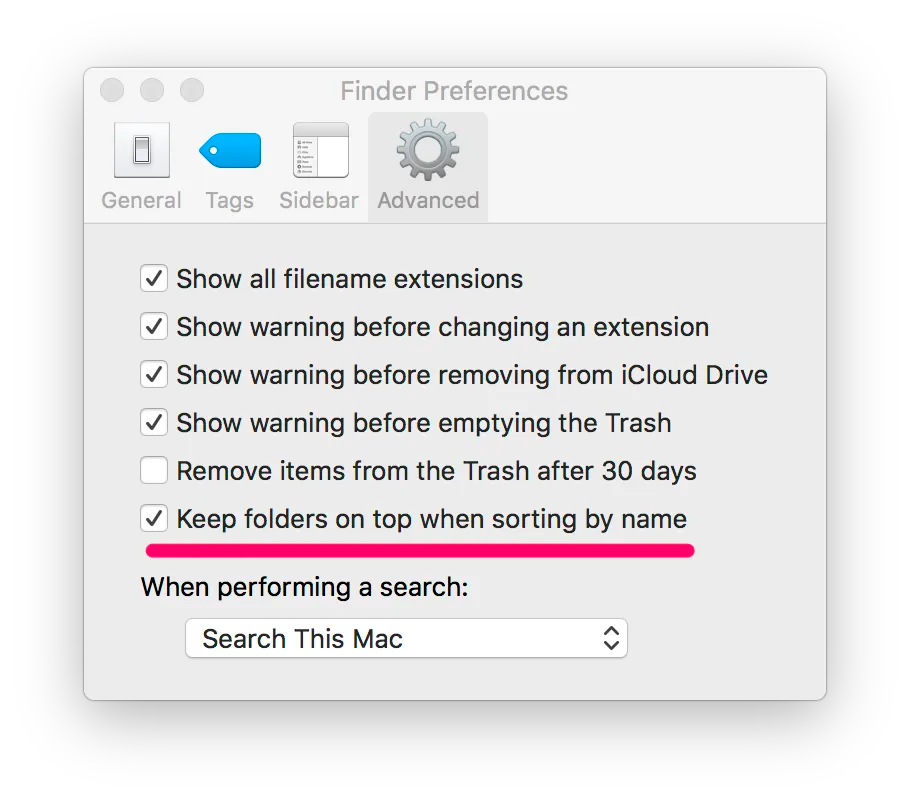
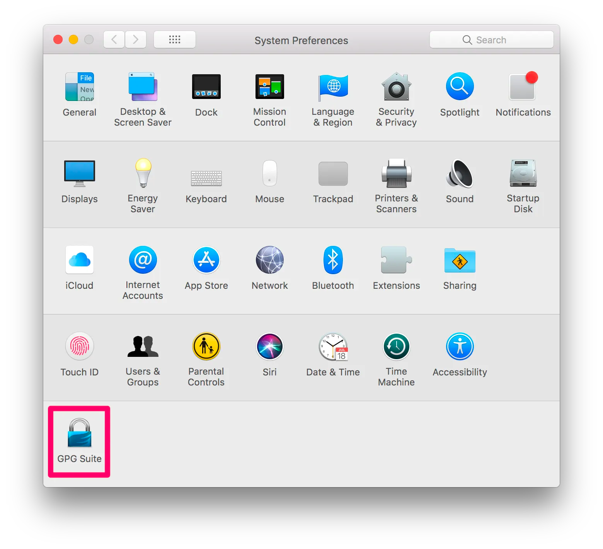
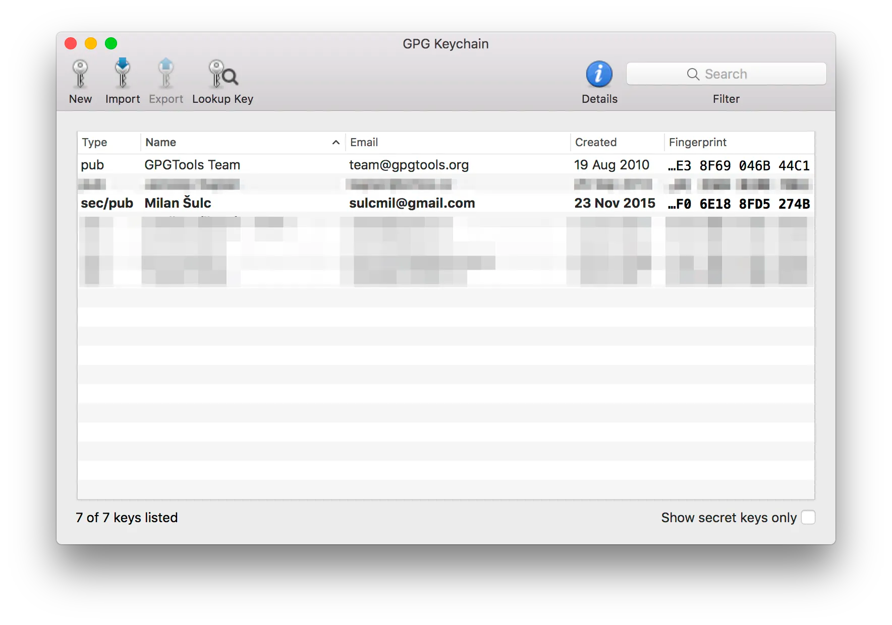
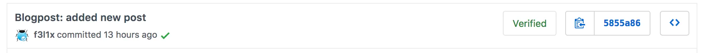
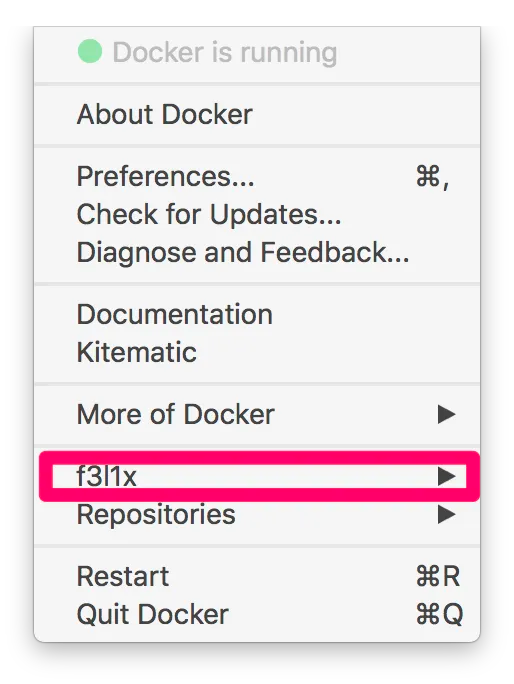
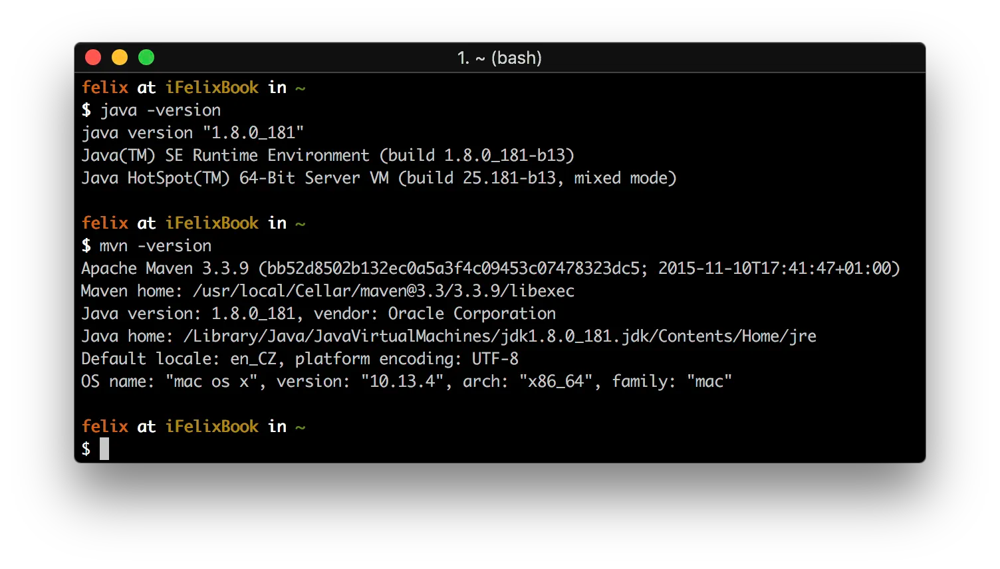
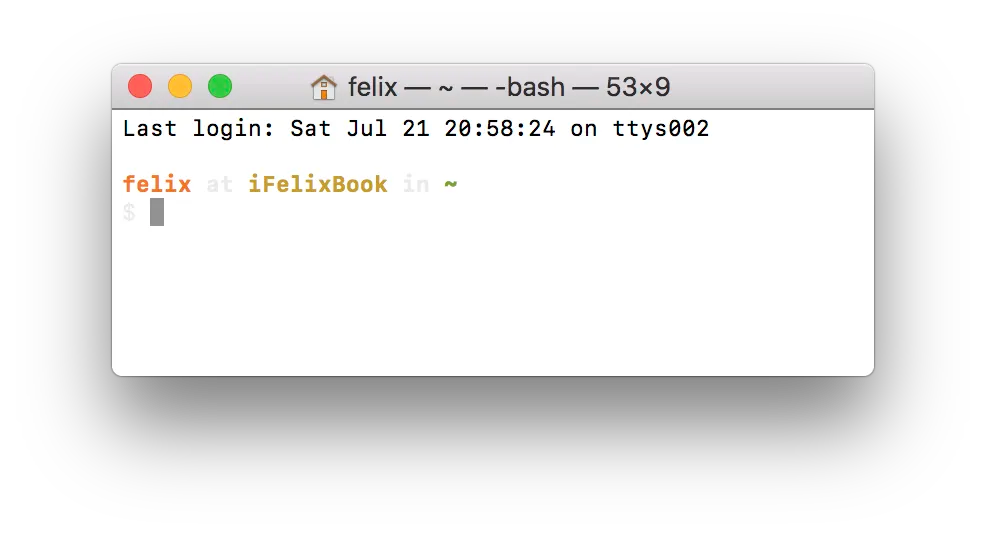
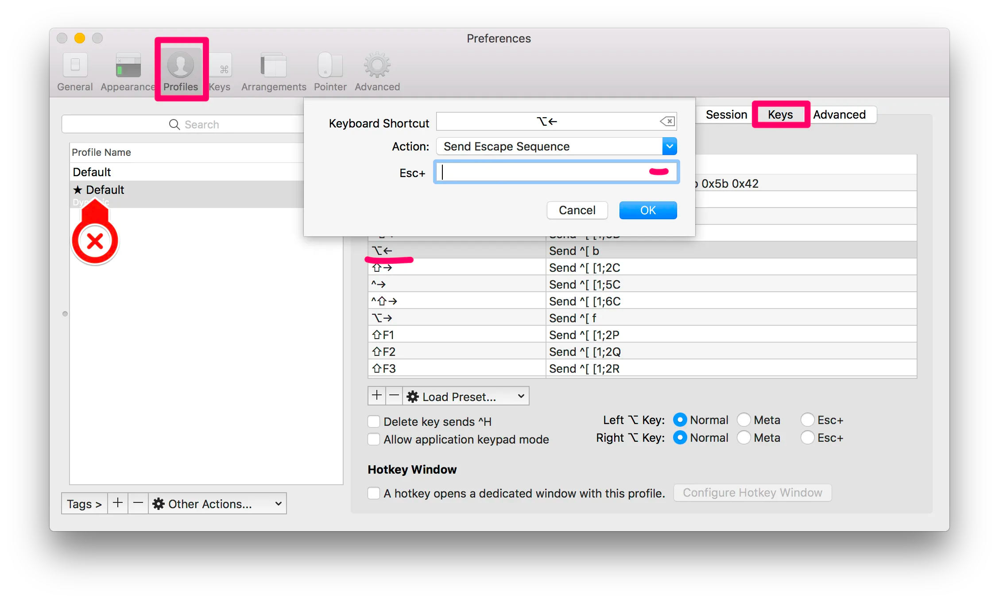

Nedávno jsem si pořídil nový MacBook a potřeboval jsem si nastavit pár věcí, aby se mi lépe pracovalo. Dlouho jsem byl výhradně na Linux Mint, takže znalost unix prostředí byla. Ale i tak toho bylo dost.

## Brew

Linux Mint vychází z Ubuntu a to vychází z Debianu, takže jsem chybějící balíčky instaloval přes `apt-get install [package]`.

Na OSX jsem žádný vestavěný balíčkovač nenašel, přislo na řadu googlení. [Brew](https://brew.sh/) se jeví jako jasná volba.

Magická formula a vše je ready.

```bash
/usr/bin/ruby -e "$(curl -fsSL https://raw.githubusercontent.com/Homebrew/install/master/install)"
```



## Finder

Finder je super. Sice ne tak super jako Total Commander, ale zvykl jsem si. Musel jsem udělat pár úprav.

**Složky vždy nahoře**



**Defaultní velikost okna**

Tohle je vážně tricky.

1.  Roztáhnete Finder na požadovanou velikost.
2.  Command + Options + W pro zavření všech oken.
3.  Option + pravé tlačítko myši a vybrat **relaunch**.

Kdo by to byl řekl, vše pak nastaveno.

### Klávesové zkratky

Klávesové zkratky jsem neměnil, ale je dobré o nich vědět.

-   Command + Shift + C – top-level Computer folder
-   Command + Shift + D – Desktop folder
-   Command + Shift + F – All My Files folder
-   Command + Shift + G – Go to Folder window
-   Command + Shift + H – Home folder for your account
-   Command + Shift + I – iCloud Drive folder
-   Command + Shift + O – Documents folder
-   Command + Shift + R – AirDrop folder
-   Command + Shift + U – Utilities folder
-   Command + Option + L – Downloads folder

Zdroj: [https://www.cnet.com/how-to/finder-shortcuts-every-mac-user-needs-to-know/](https://www.cnet.com/how-to/finder-shortcuts-every-mac-user-needs-to-know/)

## GPG Suite

Jsem zvyklý svoje commity podepisovat (měli byste i vy). Na OSX používám GPG Suite 2018.

Po nainstalovaní se vám objeví ikonka v nastavení.



Potom, co si vytvoříte a naimportujete své klíče a klíče kolegů, můžete si vyměňovat zabezpečené zprávy a také podepisovat commity.



Na Githubu to pak vypadá takhle cool.



## Docker

Docker na Macu je kapitola sama o sobě, ale to bych nerad rozebíral. Poté, co nainstalujete [Docker for Mac](https://docs.docker.com/docker-for-mac/install/), byste rádi, aby vám terminál napovídal docker příkazy.

Nejdříve je nutné přes Brew stáhnout bash-completion. Pokud používáte např. Fish nebo ZSH, pro vás toto není.

```bash
brew install bash-completion
```

Poté nalinkujeme již nainstalované completion do správného místa.

```bash
cd /usr/local/etc/bash_completion.d
ln -s /Applications/Docker.app/Contents/Resources/etc/docker.bash-completion
ln -s /Applications/Docker.app/Contents/Resources/etc/docker-machine.bash-completion
ln -s /Applications/Docker.app/Contents/Resources/etc/docker-compose.bash-completion
```

🎉 A napovídání funguje.

### Login

Po nainstalování Docker for Mac se můžete přihlásit do vašeho účtu. Přihlášení probíhá přes váš email a heslo.



Ale pozor, tím se nepřihlásíte i pro terminál. V terminálu je potřeba zadat:

```bash
docker login
```

Tam se naopak přihlašujete přes váš **username**, pozor na to.

## PHP

U PHP jsem řešil podobný problém jako u Dockeru. Chtěl jsem mít composer a aby mi terminál napovídal.

Nejdříve jsem poštval Brew nainstalovat composer.

```bash
brew install composer
```

Dále už to nebylo jednoduché, ale nakonec jsem to pořešil. Hledáním na Githubu jsem narazil na [nástroj](https://github.com/bamarni/symfony-console-autocomplete), který umí completion vygenerovat. Můžete si ho stáhnout a spustit ručně. A nebo jsem na [Gist dal výsledek](https://gist.github.com/f3l1x/f9c0668cadbef9105c5df033d8c23f6e).

```bash
wget -O /usr/local/etc/bash_completion/composer https://gist.githubusercontent.com/f3l1x/f9c0668cadbef9105c5df033d8c23f6e/raw/5fbeaa6e27202f3520667de22ffcd1fe9f6ac0bf/composer
```

## Java

Nainstalovat Javu lze zase poměrně snadno přes Brew.

```bash
brew update
brew tap caskroom/cask
brew cask install java
brew intall maven@3.3
```



## iTerm2

Defaultní terminál mi moc nevyhovoval, tak jsem dal šanci iTerm2 a byl jsem nadšen. Více nastavení, lepší vzhled.





Mnozí jistě namítnou, že i Terminal lze přestylovat… Přehled všech iTerm2 features najdete na [oficiálních stránkach](https://www.iterm2.com/features.html).

**Mazání a přeskakování slov**

Jedna věc mě přece jenom štvala. Chtěl jsem se pohybovat přes více slov, případně mazat celá slova a ne po písmenkách.

Lze to, jako vše, nakonfigurovat.


iTerm2 -> Nastavení -> Profily (vybrat) -> Keys (tab) -> přidat nebo upravit zkratku

-   Option + šipka vlevo `[Send Escape Sequence: ESC + b]` => skočit o slovo doleva
-   Option + šipka vpravo `[Send Escape Sequence: ESC + f]` => skočit o slovo doprava
-   Option + delete `[Send Hex: 0x17]` => smazat poslední slovo
-   Command + delete `[Send Hex: 0x15]` => smazat celý řádek

Budu rád, když mi do komentářů napíšete nějaké vaše tipy a triky.
