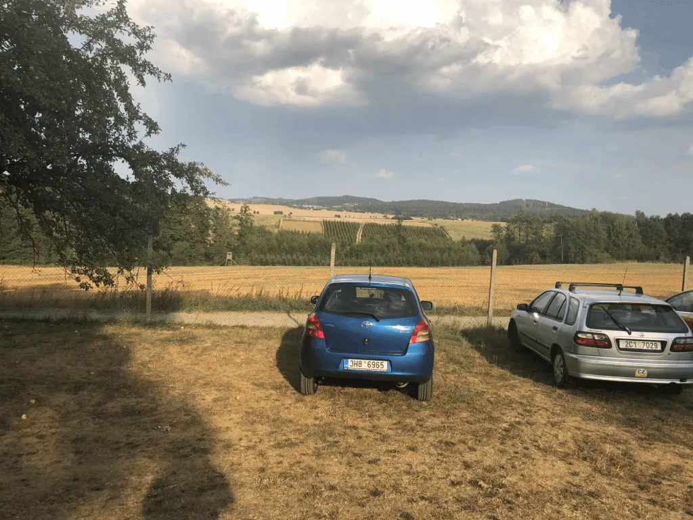
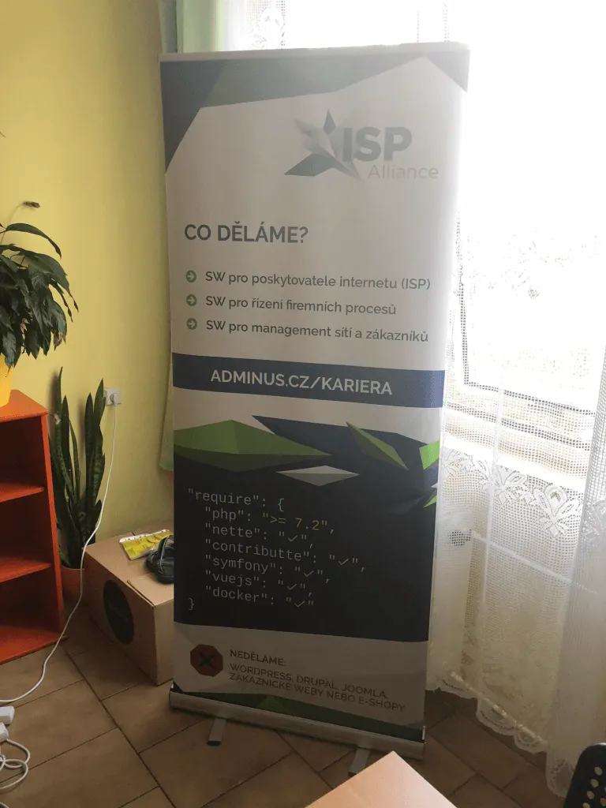
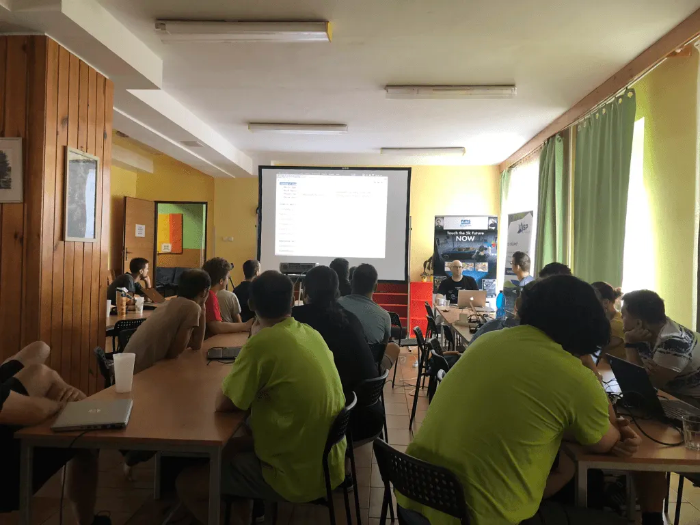
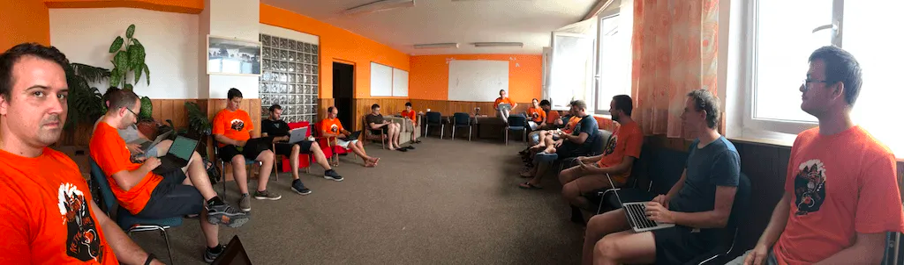
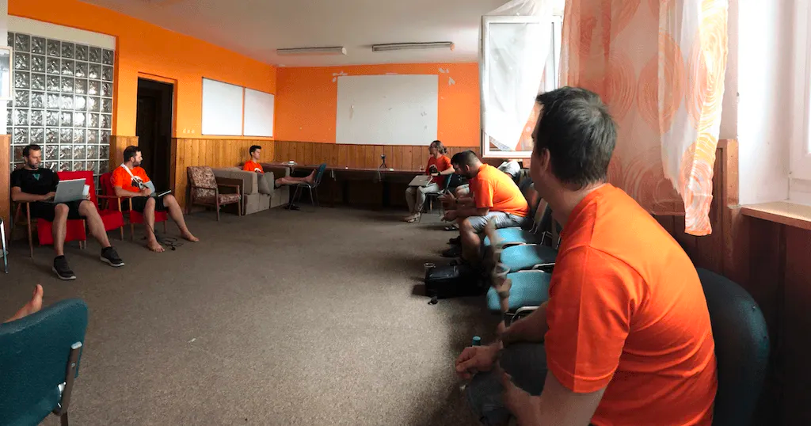
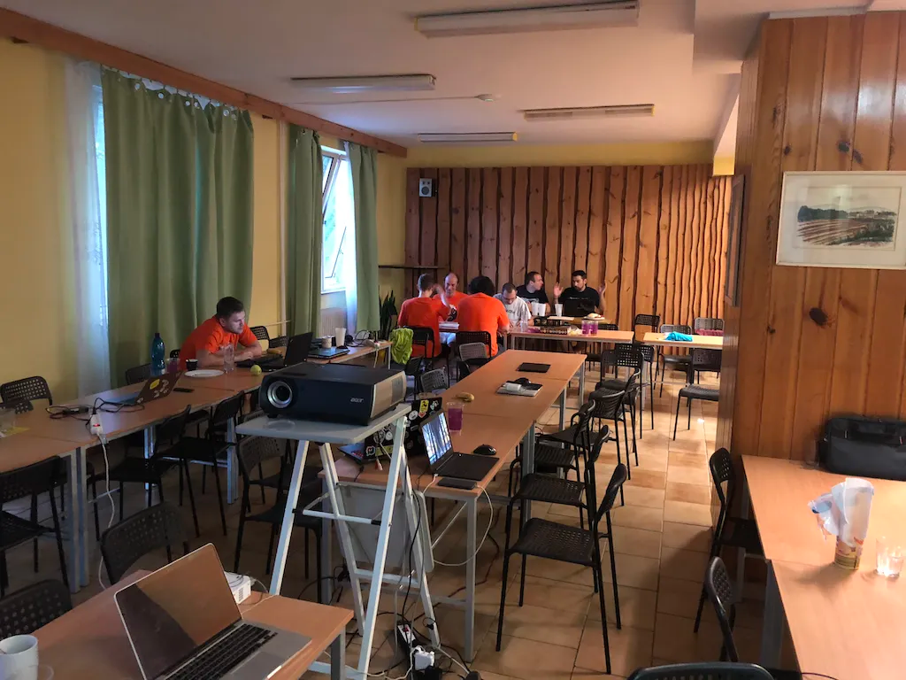
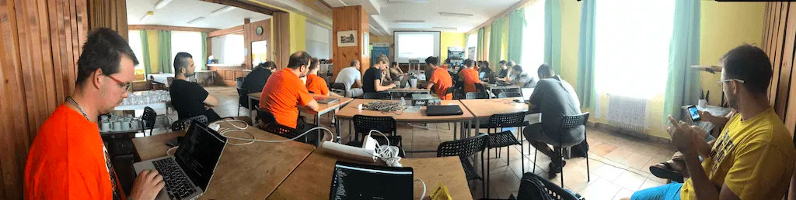
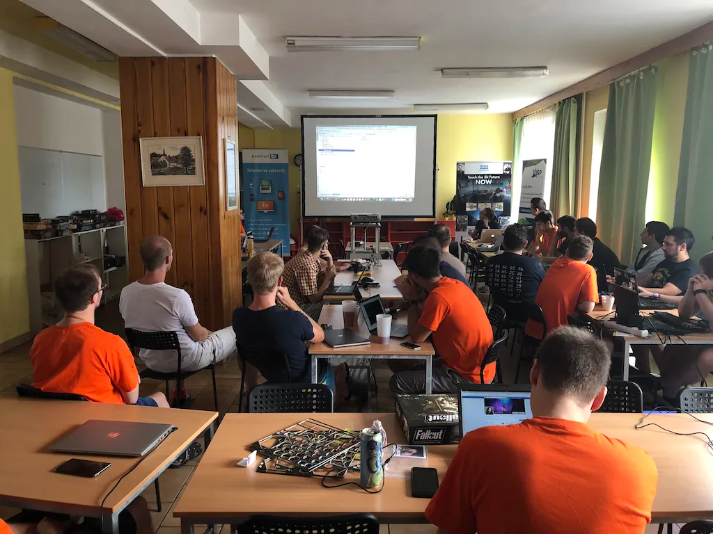
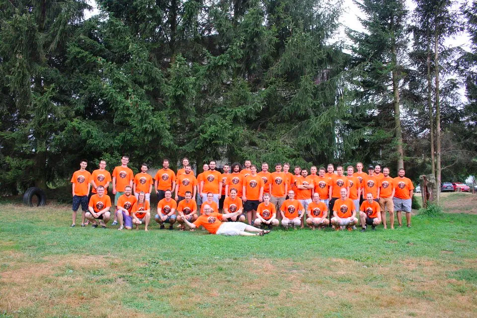

Od 23.8. do 26.8. se sjelo přes 40 vývojářů na již tradiční Nette Camp.

## Čtvrtek 23.8.

V malebné krajině bez internetu se hostí největší letní Nette Framework akce svého druhu.

Po potřebném seznámení jsme partnerům nachystali jejich rollupy. A šli networkingovat.

## Pátek 24.8.

V pátek jsme začali kontinentální snídaní a jako dezert nám [Srigi](https://twitter.com/srigi) naservíroval dopolední přednášku o Kubernetes (k8s).

Odpoledne se pokračovalo formou Barcampových přednášek, kde svoji tvořivostí vynikal hlavně [Honza Mikeš](https://github.com/janmikes).

### Barcamp: PSR7 a middlewares - Na co se hodí a na co ne?

Ve video zmíněno:

-   [https://github.com/apitte](https://github.com/apitte)
-   [https://componette.com/brandembassy/slim-nette-extension/](https://componette.com/brandembassy/slim-nette-extension/)
-   [https://componette.com/o2ps/slimnettebridge/](https://componette.com/o2ps/slimnettebridge/)

### Barcamp: Co je to CQRS, DDD a Event Sourcing a k čemu je to dobré.

## Sobota 25.8.

V sobotu šli někteří spát, když se ostatní vydávali na snídani. Takže počty posluchačů se výrazně lišily. Kromě přednášek a ukázek jsme si vyzkoušeli střelbu z luku, zahrái nohejbal, soutěžili o licence PhpStormu při střílení ze vzduchovky a nebo klasicky řešili vývojové věci.

### Jak na deployer? (Jan Kuchař) A ho použít s GitLab CI? (Honza Mikeš)

### Event Sourcing v malé low-traffic aplikaci MikroEET (Jan Kuchař)

## Nedělě 26.8

Nedělě byla již poklidná a relaxační, všichni se postupně připravovali na odjezd.

Díky všem za účast. Velké díky Chemixovi a Pétě za organizaci. A zase někdy na Nette Campu.

