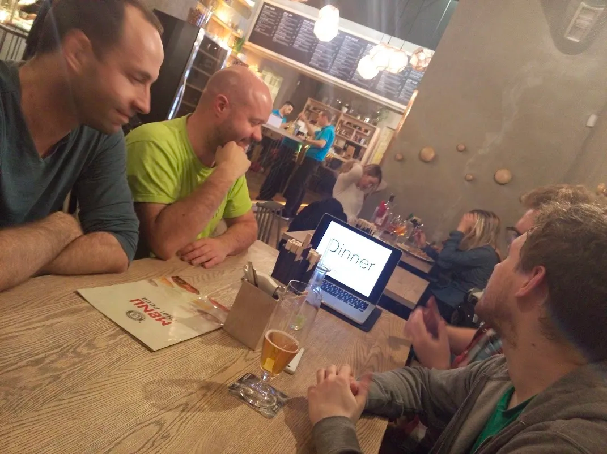

V prosinci 2017 se sešel Nette Team.

Dne 8.11.2017 kolem 17:01 se sešel Nette Team ve složení Honza Černý ([chemix](https://github.com/chemix)), David Grudl ([dg](https://github.com/dg)), Miloslav Hůla ([milo](https://github.com/milo)), Honza Tvrdík ([jantvrdik](https://github.com/jantvrdik)), David Matějka ([matej21](https://github.com/matej21)) a Milan Šulc ([felix](https://github.com/f3l1x)).

Poklábosili jsme, dali pár piv a naladili naše žaludky ostrým kari (ještě teď trpím).

Chemix byl, jako jediný, kvalitně připraven a pohostil nás prezentací.

Celkově jsme si dali za cíl se scházet častěji a více komunikovat v připravovaných věcech, jako je například:

-   Nette 3.0
-   middlewares & PSR-7
-   API?
-   vlastní pivko
-   PhpHory
-   doplňky (triko, hrnek, kalendář)

Po ukončení Nette Team Meetupu jsme přesídlili na NetteFwPivo, kde jsme hned vytvořili pivní jádro. Neboť se tam vyjímečně nikdo další neukázal.

Celkově to hodnotím kladně, kari pálilo fest.
