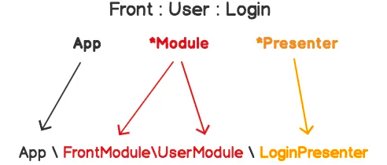

Jednoduché i složité ukázky jak mapovat Nette presentery.

Kdykoli použijeme v Nette zápis `User` nebo `Front:User` či `Front:User:Login`, Nette musí interně vytvořit instanci presenteru.

V ukázkách se pokusím vysvětlit jak mapování funguje. Detailnější pohled najdete v [dokumentaci](https://doc.nette.org/en/2.4/configuring#toc-mapping) nebo v [testech](https://github.com/nette/application/blob/ddfa3ef6079b776533b452f4d65e8116da4d3183/tests/Application/PresenterFactory.formatPresenterClass.phpt).

Defaultně máme k dispozici 2 mapování, univerzální a pro Nette modul.

```yaml
application:
    mapping:
        *: ['', '*Module', '*Presenter']
        Nette: ['NetteModule', '*', '*Presenter']
```

<table class="notion-table"><tbody><tr style="color:var(--color-text-default)"><td style="min-width:120px;max-width:240px"><div class="notion-table__cell"><span class="notion-semantic-string">Syntax</span></div></td><td style="min-width:120px;max-width:240px"><div class="notion-table__cell"><span class="notion-semantic-string">Classpath</span></div></td></tr><tr style="color:var(--color-text-default)"><td style="min-width:120px;max-width:240px"><div class="notion-table__cell"><span class="notion-semantic-string">User</span></div></td><td style="min-width:120px;max-width:240px"><div class="notion-table__cell"><span class="notion-semantic-string">UserPresenter</span></div></td></tr><tr style="color:var(--color-text-default)"><td style="min-width:120px;max-width:240px"><div class="notion-table__cell"><span class="notion-semantic-string">User:Login</span></div></td><td style="min-width:120px;max-width:240px"><div class="notion-table__cell"><span class="notion-semantic-string">UserModule</span></div></td></tr><tr style="color:var(--color-text-default)"><td style="min-width:120px;max-width:240px"><div class="notion-table__cell"><span class="notion-semantic-string">Front:User:Login</span></div></td><td style="min-width:120px;max-width:240px"><div class="notion-table__cell"><span class="notion-semantic-string">FrontModule</span></div></td></tr><tr style="color:var(--color-text-default)"><td style="min-width:120px;max-width:240px"><div class="notion-table__cell"><span class="notion-semantic-string">Nette:User</span></div></td><td style="min-width:120px;max-width:240px"><div class="notion-table__cell"><span class="notion-semantic-string">NetteModule</span></div></td></tr><tr style="color:var(--color-text-default)"><td style="min-width:120px;max-width:240px"><div class="notion-table__cell"><span class="notion-semantic-string">Nette:User:Login</span></div></td><td style="min-width:120px;max-width:240px"><div class="notion-table__cell"><span class="notion-semantic-string">NetteModule</span></div></td></tr></tbody></table>

Pokusíme se dopracovat do stavu, kdy `Front:User:Login` bude přeložen na `App\Front\User\Login\LoginPresenter`.

Přidáme prefix `App`.

```yaml
application:
    mapping:
        *: ['App', '*Module', '*Presenter']
        Nette: ['NetteModule', '*', '*Presenter']
```

<table class="notion-table"><tbody><tr style="color:var(--color-text-default)"><td style="min-width:120px;max-width:240px"><div class="notion-table__cell"><span class="notion-semantic-string">Syntax</span></div></td><td style="min-width:120px;max-width:240px"><div class="notion-table__cell"><span class="notion-semantic-string">Classpath</span></div></td></tr><tr style="color:var(--color-text-default)"><td style="min-width:120px;max-width:240px"><div class="notion-table__cell"><span class="notion-semantic-string">User</span></div></td><td style="min-width:120px;max-width:240px"><div class="notion-table__cell"><span class="notion-semantic-string">App</span></div></td></tr><tr style="color:var(--color-text-default)"><td style="min-width:120px;max-width:240px"><div class="notion-table__cell"><span class="notion-semantic-string">User:Login</span></div></td><td style="min-width:120px;max-width:240px"><div class="notion-table__cell"><span class="notion-semantic-string">App</span></div></td></tr><tr style="color:var(--color-text-default)"><td style="min-width:120px;max-width:240px"><div class="notion-table__cell"><span class="notion-semantic-string">Front:User:Login</span></div></td><td style="min-width:120px;max-width:240px"><div class="notion-table__cell"><span class="notion-semantic-string">App</span></div></td></tr><tr style="color:var(--color-text-default)"><td style="min-width:120px;max-width:240px"><div class="notion-table__cell"><span class="notion-semantic-string">Nette:User</span></div></td><td style="min-width:120px;max-width:240px"><div class="notion-table__cell"><span class="notion-semantic-string">NetteModule</span></div></td></tr><tr style="color:var(--color-text-default)"><td style="min-width:120px;max-width:240px"><div class="notion-table__cell"><span class="notion-semantic-string">Nette:User:Login</span></div></td><td style="min-width:120px;max-width:240px"><div class="notion-table__cell"><span class="notion-semantic-string">NetteModule</span></div></td></tr></tbody></table>

Odstraníme opakující se slovo `Module`. Moje oblíbená verze.

```yaml
application:
    mapping:
        *: ['App', '*', '*Presenter']
        Nette: ['NetteModule', '*', '*Presenter']
```

<table class="notion-table"><tbody><tr style="color:var(--color-text-default)"><td style="min-width:120px;max-width:240px"><div class="notion-table__cell"><span class="notion-semantic-string">Syntax</span></div></td><td style="min-width:120px;max-width:240px"><div class="notion-table__cell"><span class="notion-semantic-string">Classpath</span></div></td></tr><tr style="color:var(--color-text-default)"><td style="min-width:120px;max-width:240px"><div class="notion-table__cell"><span class="notion-semantic-string">User</span></div></td><td style="min-width:120px;max-width:240px"><div class="notion-table__cell"><span class="notion-semantic-string">App</span></div></td></tr><tr style="color:var(--color-text-default)"><td style="min-width:120px;max-width:240px"><div class="notion-table__cell"><span class="notion-semantic-string">User:Login</span></div></td><td style="min-width:120px;max-width:240px"><div class="notion-table__cell"><span class="notion-semantic-string">App</span></div></td></tr><tr style="color:var(--color-text-default)"><td style="min-width:120px;max-width:240px"><div class="notion-table__cell"><span class="notion-semantic-string">Front:User:Login</span></div></td><td style="min-width:120px;max-width:240px"><div class="notion-table__cell"><span class="notion-semantic-string">App</span></div></td></tr><tr style="color:var(--color-text-default)"><td style="min-width:120px;max-width:240px"><div class="notion-table__cell"><span class="notion-semantic-string">Nette:User</span></div></td><td style="min-width:120px;max-width:240px"><div class="notion-table__cell"><span class="notion-semantic-string">NetteModule</span></div></td></tr><tr style="color:var(--color-text-default)"><td style="min-width:120px;max-width:240px"><div class="notion-table__cell"><span class="notion-semantic-string">Nette:User:Login</span></div></td><td style="min-width:120px;max-width:240px"><div class="notion-table__cell"><span class="notion-semantic-string">NetteModule</span></div></td></tr></tbody></table>

A nakonec zduplikujeme název presenteru do namespace.

```yaml
application:
    mapping:
        *: ['App', '*', '*\*Presenter']
        Nette: ['NetteModule', '*', '*Presenter']
```

<table class="notion-table"><tbody><tr style="color:var(--color-text-default)"><td style="min-width:120px;max-width:240px"><div class="notion-table__cell"><span class="notion-semantic-string">Syntax</span></div></td><td style="min-width:120px;max-width:240px"><div class="notion-table__cell"><span class="notion-semantic-string">Classpath</span></div></td></tr><tr style="color:var(--color-text-default)"><td style="min-width:120px;max-width:240px"><div class="notion-table__cell"><span class="notion-semantic-string">User</span></div></td><td style="min-width:120px;max-width:240px"><div class="notion-table__cell"><span class="notion-semantic-string">App</span></div></td></tr><tr style="color:var(--color-text-default)"><td style="min-width:120px;max-width:240px"><div class="notion-table__cell"><span class="notion-semantic-string">User:Login</span></div></td><td style="min-width:120px;max-width:240px"><div class="notion-table__cell"><span class="notion-semantic-string">App</span></div></td></tr><tr style="color:var(--color-text-default)"><td style="min-width:120px;max-width:240px"><div class="notion-table__cell"><span class="notion-semantic-string">Front:User:Login</span></div></td><td style="min-width:120px;max-width:240px"><div class="notion-table__cell"><span class="notion-semantic-string">App</span></div></td></tr><tr style="color:var(--color-text-default)"><td style="min-width:120px;max-width:240px"><div class="notion-table__cell"><span class="notion-semantic-string">Nette:User</span></div></td><td style="min-width:120px;max-width:240px"><div class="notion-table__cell"><span class="notion-semantic-string">NetteModule</span></div></td></tr><tr style="color:var(--color-text-default)"><td style="min-width:120px;max-width:240px"><div class="notion-table__cell"><span class="notion-semantic-string">Nette:User:Login</span></div></td><td style="min-width:120px;max-width:240px"><div class="notion-table__cell"><span class="notion-semantic-string">NetteModule</span></div></td></tr></tbody></table>

Jak je vidno, upravit mapování k našemu obrazu není tak složité. Důležité je si uvědomit, které části se opakují. Více napoví obrázek.


