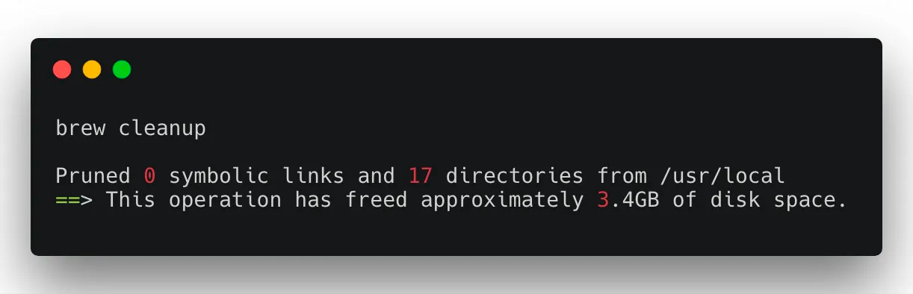

Používáte brew na instalaci balíčků? A co používáte na čištění starých balíčků?

Brew je mým společníkem od dob co jsem na OSX (:apple:). Pomáhá mi s instalací balíčků.

Nainstalovat poslední PHP 7.3? No problema!

```bash
brew install php@7.3
```

Aktualizovat Node.js nebo yarn?

```bash
brew install nodejs yarn
brew upgrade
```

A co desktop aplikace? Na to je **brew cask**.

```bash
brew cask install transmission
brew cask install vlc
brew cask install google-chrome
brew cask install now
```

Jasně, kupa aplikací lze nainstalovat pekně přes dmg, ale pak je otrava je aktualizovat. S brew cask? Hračka!

```bash
brew cask upgrade
```

Po pořádné práci je potřeba si uklidit. Nechceme přece, aby se nám po systému válely staré a nepoužívané aplikace.

```bash
brew cleanup
```

Po roce používání a nečištění to pak dopadá takto.



Používáte brew? Máte nějaké osvědčené rady a triky?
