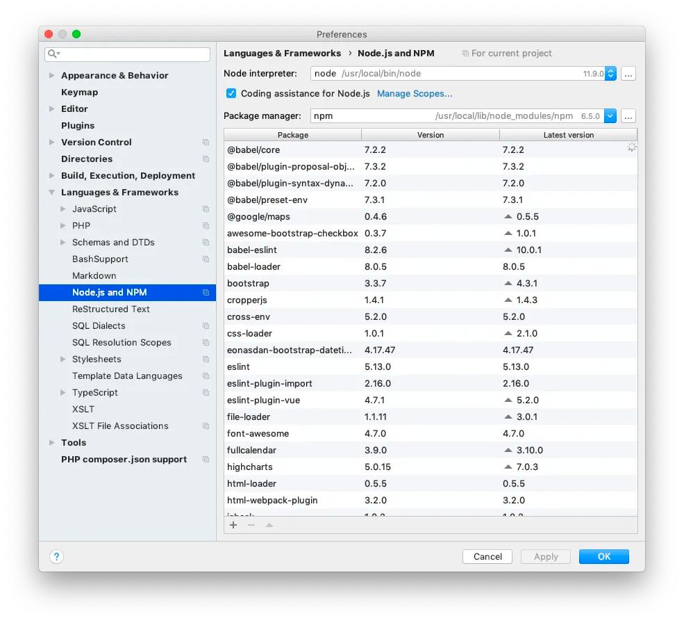

Jak poznat, že máte neaktualizované NPM balíčky a jak je aktualizovat.

Držet projekt na posledních verzích knihoven není lehká věc. Člověk rychle zabředne do doručovaní nových feature a přestane aktualizovat svůj stack.

Pokud se jedná o NPM svět, tak máte téměř jistotu, že každý den vyjde nová verze nějaké knihovny, co právě používáte.

Jak tedy zjistit co aktualizovat? Pomůže nativní command.

```bash
npm outdated
```

Výstup z `npm outdated` může vypadat třeba takto.

Pokud používáte PhpStorm, tak podobný výpis naleznete na **Languages & Frameworks** -> **Node.js and NPM**.



Poté můžete aktualizovat všechny balíčky a nebo jenom vybrané. Defaultně nám NPM updatuje jenom balíčky pod klíčem `dependencies`, pro vývojové zavislosti přidáme nakonec `--dev`.

```bash
# dependencies
npm update

# solo dependency
npm update vue

# devDependencies
npm update --dev
```

Jak aktualizujete NPM balíčky vy? Máte nějaké osvědčené rady a triky?
