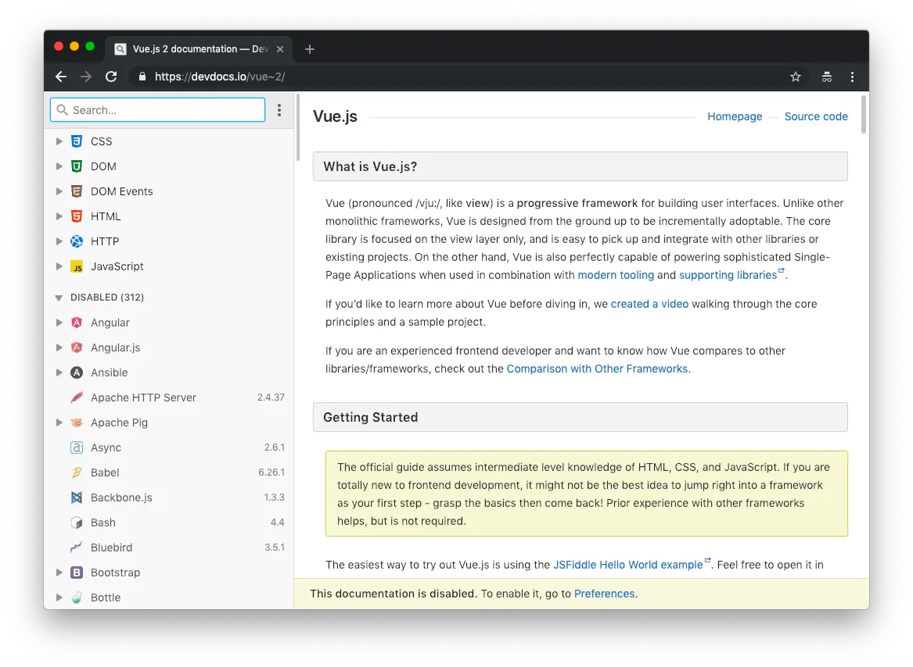

Desítky dokumentací ke všem možným nástrojům na devdocs.io.

Určitě znáte agregátor dokumentací [devdocs.io](https://devdocs.io/). Na Zdrojáku o tom psal Martin Hassman už v roce 2013.

Za tu dobu tam přibylo neuvěřitelně moc nástrojů, přes 2500 commitů. Je znát, že to opravdu žije. Pro mě hlavně o Vue.js a celkově ekosystemu kolem Vue. Není na škodu si však připomenout např. nastavení u Apache nebo Nginx.

Že bychom se hecli a přidali tam podporu pro Nette? Přidá se někdo?

Zdroják:

-   [https://www.zdrojak.cz/zpravicky/devdocs-se-rozrusta-pridejte-si-zalozek/](https://www.zdrojak.cz/zpravicky/devdocs-se-rozrusta-pridejte-si-zalozek/)
-   [https://www.zdrojak.cz/zpravicky/devdocs-pro-webove-vyvojare/](https://www.zdrojak.cz/zpravicky/devdocs-pro-webove-vyvojare/)
