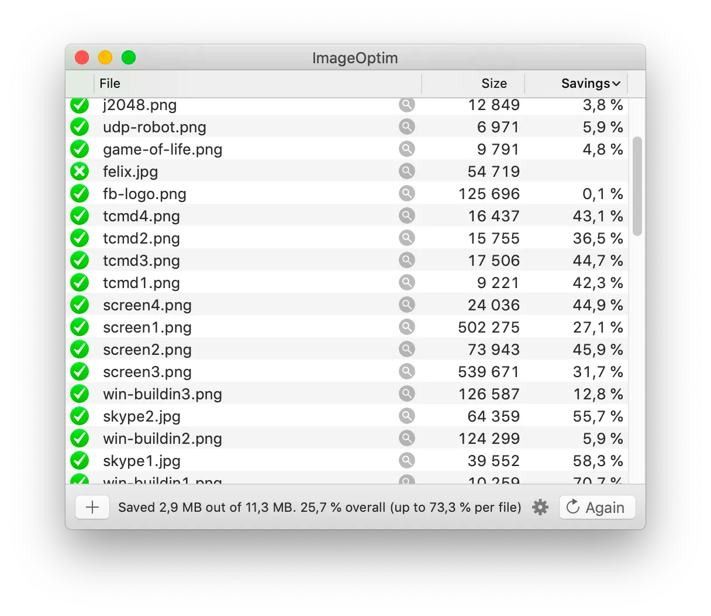
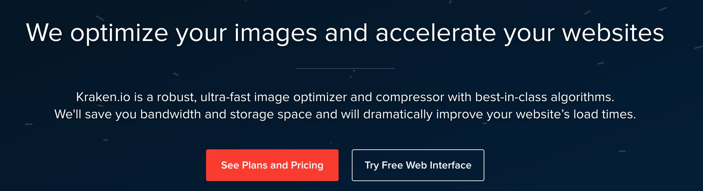
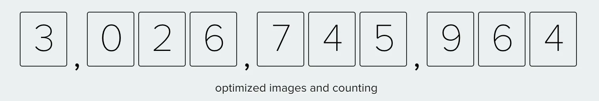
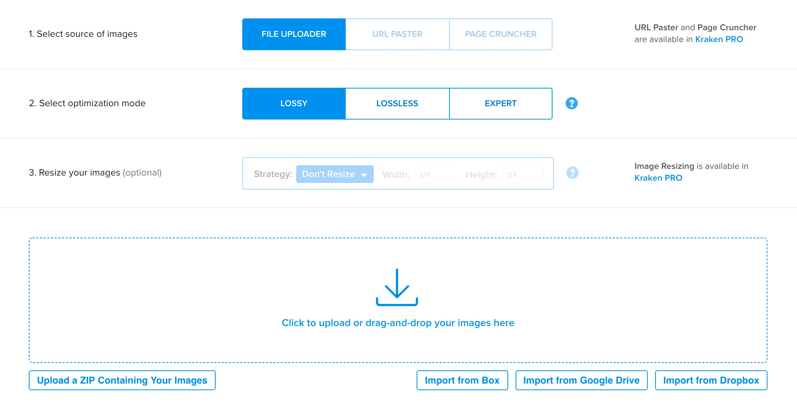

Potřebujete dávkově minifikovat obrázky? Zkuste ImageOptim nebo Kraken.

Čas od času, každý, kdo tvoří weby, potřebuje zkomprimovat nějaký ten obrázek. Nedávno mi jeden kamarád ukázal nástroj jménem [ImageOptim](https://imageoptim.com/).

Dokáže komprimovat různé formáty a hlavně - umí to dávkově. Už nemusíte otravně jeden po jednom, nadávkujete a komprimujete. Otestujte sami. Když budete offline, určitě se hodí ho mít.

Ješte bych vám rád ukázal jeden nástroj, tentokrát online nástroj jménem [Kraken.io](https://kraken.io/web-interface).

Na homepage má i statistiku, která vypadá, že je rozsáhle používaný.

Pokud si službu nechcete předplácet, tak umožňuje přes free webový interface nahrát obrázky (maximálně do 1mb / obrázek) a provede se automatická komprese. Máte k dispozici i základní nastavení, kde se dá zvolit míra komprese či kvalita.

Pokud jste online a vaše obrázky jsou maximálně do 1mb / obrázek, tak z Kraken.io dokážete vyždímat ještě více než z ImageOptim.

Podobné nástroje a služby:

-   https://tinypng.com
-   https://tinyjpg.com
-   https://jakearchibald.github.io/svgomg/
-   https://vecta.io/nano
-   https://squoosh.app
-   https://compressor.io/compress
-   https://www.remove.bg/
-   https://www.websiteplanet.com/webtools/imagecompressor/

Co používáte vy na minifikaci? Napište mi do komentářů.
