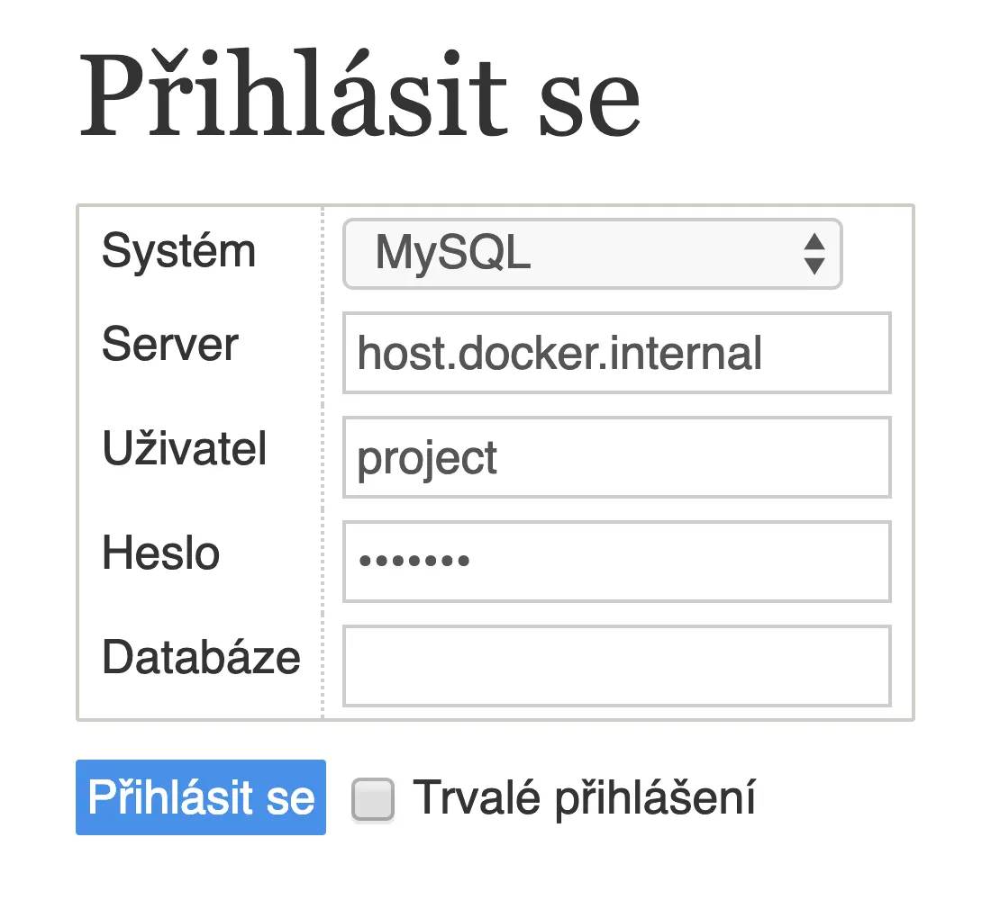

Zvykl jsem si používat při vývoji lokální PHP a Adminer + DB v Dockeru.

Už skoro 2 roky vyvýjím PHP aplikace bez Dockeru. Myslím tím, že mam nainstalované PHP přes Brew lokálně.

To, že je Docker na OSX pomalý, [není žádná novinka](https://github.com/docker/for-mac/issues?utf8=%E2%9C%93&q=osx+slow), každý kdo s Dockerem někdy na OSX pracoval na to jistě narazil. Dá se to potunit ruznými způsoby, ja osobně jsem si nainstaloval [PHP lokálně](/blog/2019/brew-install-upgrade-a-cleanup) a nemůžů si to vynachválit.

No jo, ale statických projektů tolik není, co s databází? Tu naopak v Dockeru spouštím.

Je libo MariaDB 10.4?

```bash
docker run \
    -it \
    -d \
    -p 3306:3306 \
    --name xproject_mariadb \
    -e MYSQL_ROOT_PASSWORD=rootpw \
    -e MYSQL_DATABASE=project \
    -e MYSQL_USER=project \
    -e MYSQL_PASSWORD=project \
    mariadb:10.4
```

Je libo Postgres 11?

```bash
docker run \
    -it \
    -d \
    -p 5432:5432 \
    --name xproject_postgres \
    -e POSTGRES_PASSWORD=project \
    -e POSTGRES_USER=project \
    postgres:11
```

Databázi bychom měli, ještě do ní budeme koukat přes Adminer. Mrkněte na image [dockette/adminer](https://github.com/dockette/adminer/), je fakt tenkej.

```bash
docker run \
    -it \
    -d \
    -p 9999:80 \
    --link xproject_adminer \
    --name xproject_adminer \
    dockette/adminer:dg
```

Na OSX je pak vychytávka v podobě `host.docker.internal`, která funguje jako hostname. Kontejner s Adminerem se pak dokáže spojit s hostem a jelikož máme MariaDB kontejner vystavený na portu 3306, tak se k němu dokáže Adminer spojit.



A k tomu všemu jsem si oblíbil Makefile. Proč to celé nemít zautomatizované?

Já realně pracuji na 1 projektu naráz, ale pokud často přepínáte, můžete si udělat jednu společnou DB pro všechny projekty a nebo mít ruzné porty pro různé DB.

A jak vyvijíte vy? Podělte se o vaše vychytávky.
