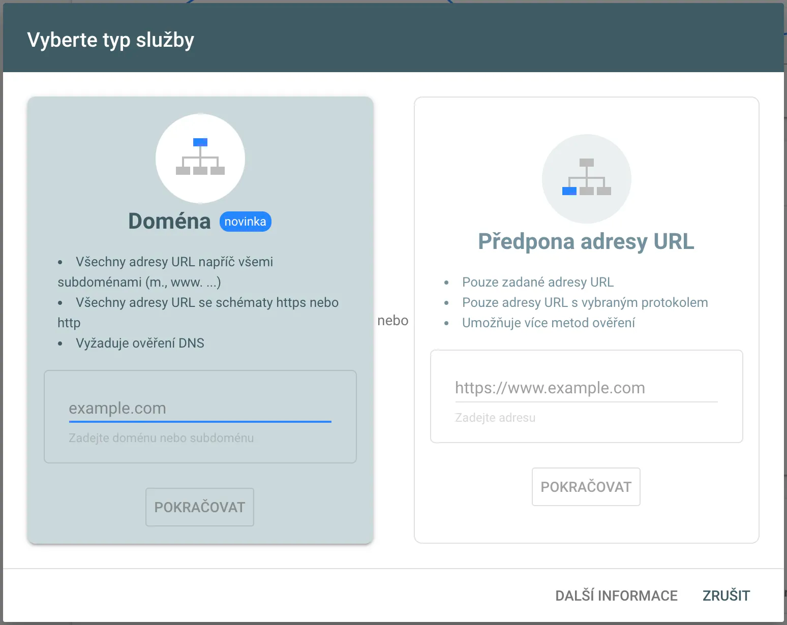
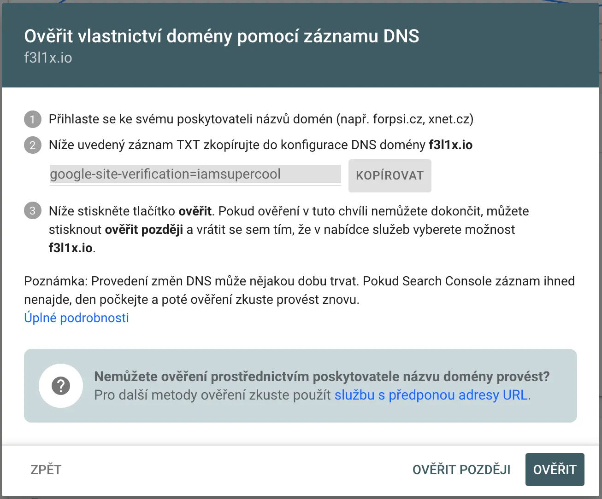
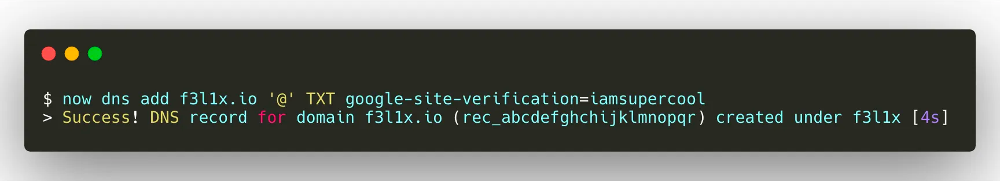
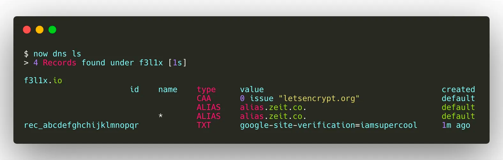

Jak si přidat web do Google Search Console s využitím ZEIT Now.

Co je [ZEIT](/blog/2019/zeit-now-migrace-dev-domny-do-cloudu) jsem už psal v předchozím článku, tak jeho popis přeskočím a vrhnem se rovnou na vložení webu do Google Search Console.

Na stránce search.google.com klikneme v rozbalovacím menu na `Přidat službu`.



Vybereme ověření dle domény.



A vyplníme naši doménu. Teď přichází na řadu úprava DNS.

Now nám říká, že máme přidat TXT záznam `google-site-verification=iamsupercool`. Pojďme na to.

```bash
now dns add f3l1x.io '@' TXT google-site-verification=iamsupercool
```

Rozeberme si to po částech:

-   `now dns add` - chci přidat nový DNS záznam
-   `f3l1x.io` - doména
-   `'@'` - platí pro celou doménu (např. `www` by platilo jenom pro `www.f3l1x.io`)
-   `TXT` - typ DNS záznamu (např. A, AAAA, MX, TXT, atd.)
-   `google-site-verification=iamsupercool` - hodnota DNS záznamu



Vypadá, že se vše povedlo. Jěště to raději ověříme.

```bash
now dns ls
```

Dle vylistovaných DNS záznamů vše vypadá v pořádku.



Ve vaší Google Search Consoli pak uvidíte, že je doména ověřená pomocí domény. Jelikož jsem již moji doménu předtím ověřil přes nahraný HTML soubor, je vidět dvojí ověření.

Verifikace přes DNS je jednoduchá, nemusíte nikam nic nahrávat nebo verzovat soubory. Terminálu a ZEIT Now tomu dodáva ještě další level.
