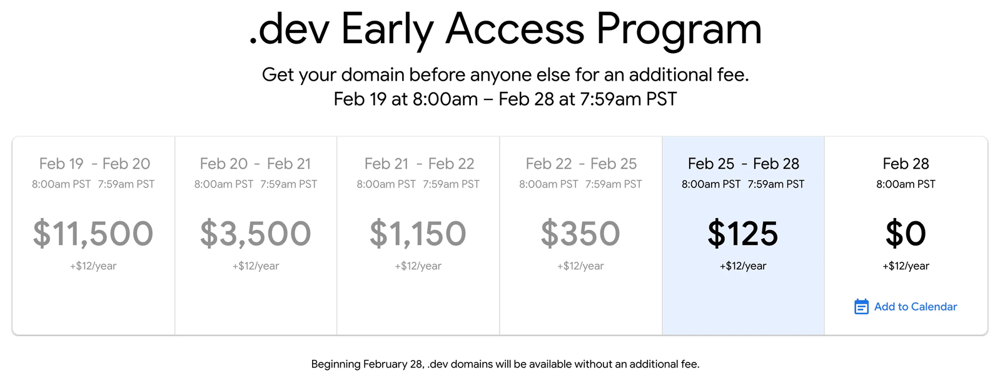
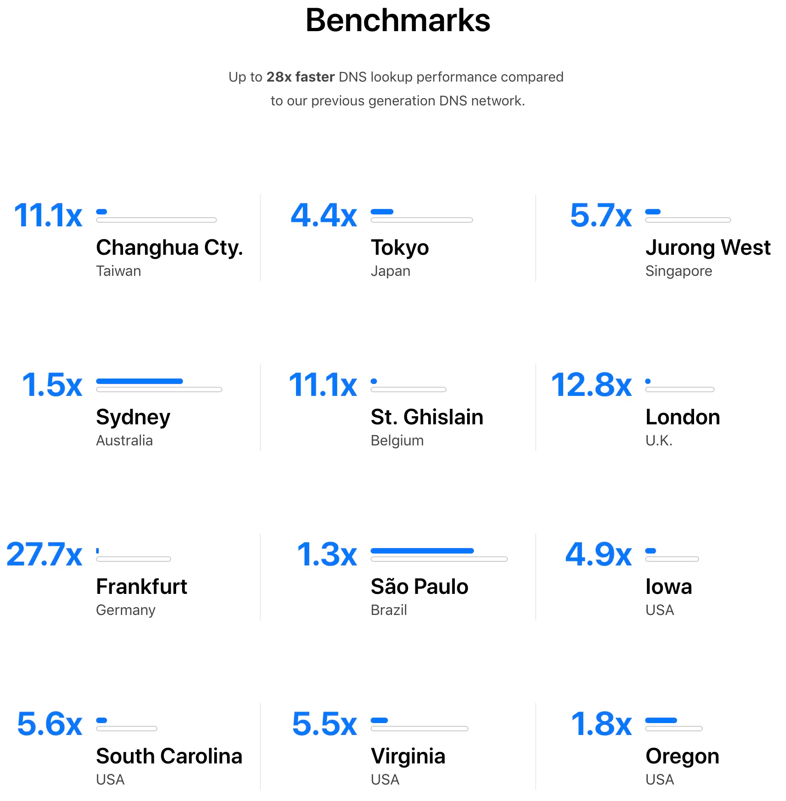
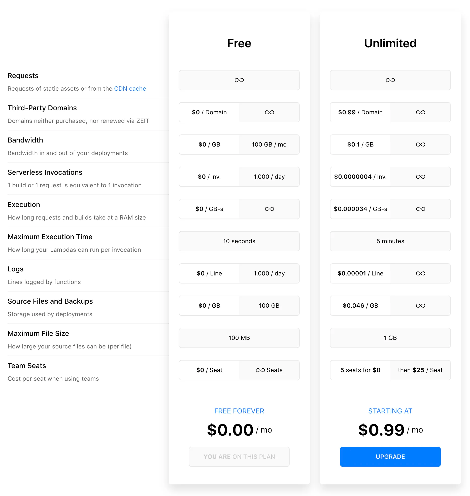
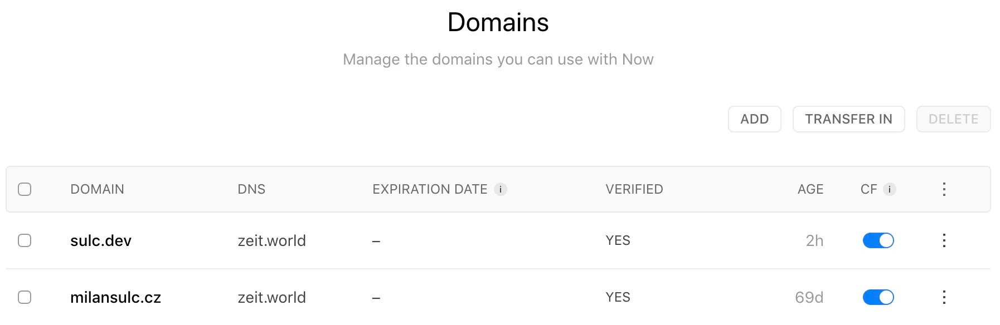

13 let jsem čekal na správnou doménu, a pak jsem ji rovnou hodil do cloudu.

`<off-topic>`

Od doby, co Google oznámil, že bude prodávat domény s koncovkou **.dev**, jsem se těšil, že si udělám radost. Čekal jsem, než se Google vysloví a nechá mi si tu doménu koupit. Ona taková doména `felix.dev` zní fakt cool. Od pradávna totiž bojuju s tím, že mi můj táta a jmenovec vyfouknul skoro všechy pěkný domény a e-mailové účty. Chtěl jsem mít e-mail `milansulc@gmail.com`, ale nebyl jsem očividně první.

Tenkrát, zhruba před 13 lety, jsem si tedy založil e-mail `rkfelix@gmail.com`, RK znamená Rychnov nad Kněžnou. Tenkrát mi to nevadilo, ale když ho někomu dnes diktuji, není to moc profesionální.

Doménu `milansulc.cz` jsem nakonec získál, ale za prvé je dlouhá a za druhé, co zvolit jako prefix, `info@milansulc.cz`? `chci@milansulc.cz`? `dycky@milansulc.cz`? To snad radši ne. Tudy cesta taky nevede.

Pak jsem objevil koncovku `.xyz` asi za 1 $, ale už asi tušíte, proč je tak levná…

Nicméně, když se začaly rozšiřovat koncovky `.io`, tak jsem znovu přisel pozdě. Nakonec jsem si zaregistroval {hackerskou} doménu `f3l1x.io` (tady právě jste), ale jak poznamenal [Honza Černý](https://twitter.com/chemix_cz) (chemix): „S tím se nikdo vypisovat nebude.“ Nuže, doufám, že backlinky odvedou svoji práci.

A konečně se dostáváme do doby zhruba 2 týdny zpět, kdy si dávám do kupy seznam domén, co si koupím. Pochopitelně `felix.dev` nechybí, event v kalendáři na den, kdy Google uvolňuje registrace bez navýšení mám, všechno vypadá slibně.

Dnes, **27.2.2019**, pravidelně kontroluju stav domén a co nevidím. Moji, jako fakt, moji doménu `felix.dev` někdo koupil. Dprdl. On si to fakt někdo koupil v předprodeji, za takový prachy, kroutím hlavou.



Moje záložní doména `sulc.dev` je stále volná. Dnes stojí 12 $ + 125 $, asi na provoz Google serverů. Od zítra stojí jenom 12 $. Svolávám rodinný sněm. Všichni truchlí se mnou. Během pár minut máme jasno, nebudeme váhat a koupíme si za 3000,- Kč `sulc.dev`. Protože přece `milan@sulc.dev` je ultra cool. Right?

`</off-topic>`

Pojďme se podívat, co to ten [ZEIT](https://zeit.co/) je a s čím nám může pomoci. Nutno dodat, že jsem si prošel přes Azure, AWS až ke GCP, ale ZEIT je pro mě jasnej objev roku 2018.

Azure, AWS i GCP mají vlastní HW/SW. Vy si můžete koupit nějakou službu nebo výkon a přes jejich admin nástroje/konzole ho spravovat. ZEIT stojí bokem, resp. nad těmito cloudy a pomocí svého API je ovládá. Vy jen říkáte, že chcete nahrát **někam** svůj statický obsah nebo třeba kus PHP/JS/Go/Python kódu, ale už se nestaráte, jestli je to realně hostované u GCP nebo třeba u AWS. To za vás řeší ZEIT a řeší to opravdu pěkně. Tím myslím vývojářsky, přes konzoli.

Nejdříve nainstalujeme nástroj `now`, jak [radí dokumentace](https://zeit.co/docs/v2/getting-started/installation/). Vytvoříme účet, přihlásíme, atd.

```bash
npm install -g now
now login
```

Takhle vypadá `now -h`.

Doménu máme, chceme ji přidat do správy ZEIT. Proč?



1.  Bude hostovaná na rychlé infrastruktuře, kterou [ZEIT provozuje s CloudFlare](https://zeit.world/).
2.  DNS spravujete přes konzoli, ne admin rozhraní, fakt přes terminál, jako pravej geek.
3.  ZEIT má velmi štědrý free tarif, idealní na prototypování nebo vlastní web.



Přidáme doménu přes terminál.

```text
$ now domains add sulc.dev
```

Že se vše podařilo, víte hned.

Jak je vidět, ZEIT doporučuje změnit NS na jejich servery, abyste doménu mohli pohodlně spravovat. Lze nasměrovat i CNAME, ale doporučuju změnit komplet NS, ničemu to nevadí.

Potom, co je doména připojena k vašemu účtu, se čeká na verifikaci, kdy ZEIT ověřuje, že jste správně nastavili NS záznamy.



Jakmile dojde k verifikaci, můžete svoji doménu ovládat kompletně přes terminál. Např. nastavit si MX záznamy.

Zobrazíme si nápovědu přes `now help dns`.

A přidáme MX záznamy.

```text
$ now dns add sulc.dev '@' MX mx1.example.com 10
> Success! DNS record for domain sulc.dev (rec_0123456789abcdefg1) created under f3l1x [1m]

$ now dns add sulc.dev '@' MX mx2.example.com 20
> Success! DNS record for domain sulc.dev (rec_0123456789abcdefg2) created under f3l1x [1m]
```

Takhle jednoduché to je. Znáte ZEIT? Používáte ho na něco? Podělte se do diskuze.
