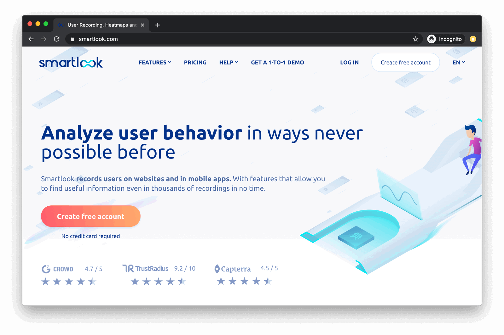
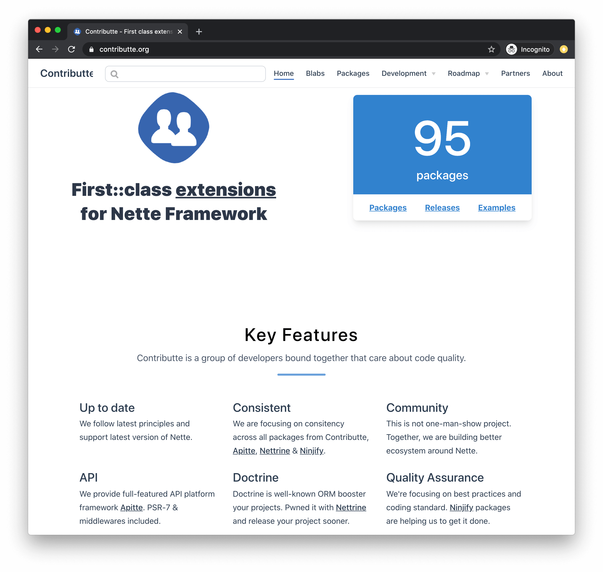
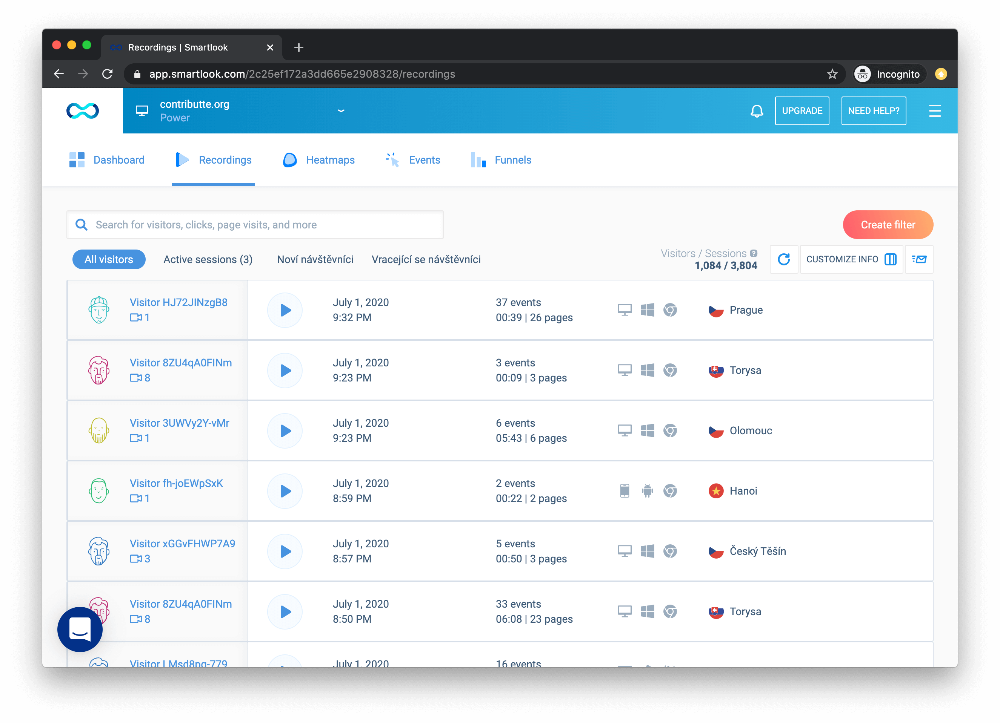
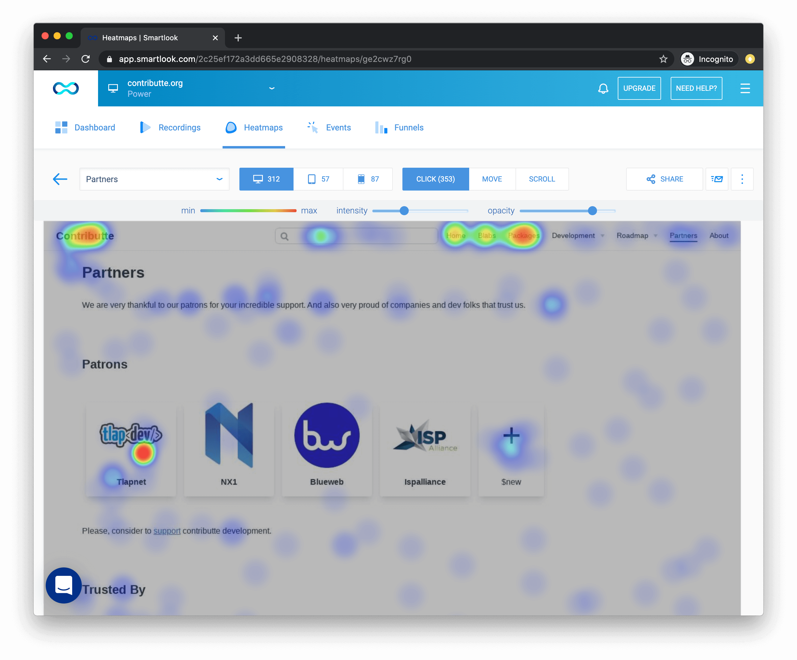

Jak napojit Smartlook do statického generátoru stránek VuePress?

[VuePress](https://vuepress.vuejs.org/) je statický generátor stránek, vhodný zejména pro dokumentace. Je napsaný ve Vue.js, podporuje řadu pluginů a můžete si tam spoustu věcí dopsat. Používám ho na menší i větší projekty, dokonce jsem ho pro projekt [contributte.org](https://contributte.org/) ohnul tak, že se ještě teď otřásá v základech. O tom ale jindy.

Každý chce vědet, jestli má jeho projekt smysl. Jak poznat, že webová stránka má smysl? Monitorujme návštěvnost. Existuje celá řada nástrojů, nejen [Google Analytics](https://analytics.google.com/). Třeba aktuálně, v roce 2020, se celkem diskutuje o [Fathom Analytics](https://usefathom.com/) se zaměřením na bezpečnost a soukromí, takže by vaše osobní data měla být v bezpečí.

Nebylo by ale skvělé vidět, na co uživatel kliknul? Reálně mít třeba video z jeho návštěvy? To by se krásně ladilo UX / UI. Já na to používám [Hotjar](https://www.hotjar.com/) nebo [Smartlook](https://smartlook.com/).

Smartlook je služba, která mi je přece jen blíže, vyvíjí ji totiž Češi. A nejen to, ovládání je velmi příjemné.



Po zaregistrování a přidání projektu musíte udělat jedinou věc. Vložit do stránky monitorovací script.

So far, so good. Tohle funguje dobře, na můj statický web jsem to přidal během pár minut. Když máme SPA, kde přechody mezi stránkami řídí kompletně javascript, bylo by pěkně říct Smartlooku, že se něco děje. Také, když [VuePress](https://vuepress.vuejs.org/) má [plugin API](https://vuepress.vuejs.org/plugin/), nešlo by to uživateli trochu zpříjemnit? Šlo!

Nainstalujeme `vuepress` a `vuepress-plugin-smartlook`.

```bash
npm install vuepress vuepress-plugin-smartlook --save
```

A do [konfiguračního souboru](https://vuepress.vuejs.org/guide/directory-structure.html#directory-structure) zaregistrujeme plugin.

```javascript
module.exports = {
  title: "Your awesome site",
  plugins: [
    [
      'vuepress-plugin-smartlook',
      {
        id: "**smartlook*key**"
      }
    ]
  ]
};
```

Díky `vuepress-plugin-smartlook` se integrace Smartlook služby celkem zjednodušuje. Plugin se umí napojit na Vue Router a odesílat informace o routování.

```javascript
router.afterEach(function (to) {
    window.smartlook('navigation', to.fullPath);
});
```

Celé toto řešení je otestováno na webu [contributte.org](https://contributte.org/).

Contributte - First::class extensions for Nette Framework



Po přihlášení je vidět přehled návštěv. Každou lze rozkliknout a přehrát si video.

Smartlook - přehled návštěv



Dostupná je i heatmapa, která barevně indikuje, kam uživatelé nejčastěji klikají.

Smartlook - heatmap



Znáte Smartlook? Používáte? Napište mi do komentářů.
