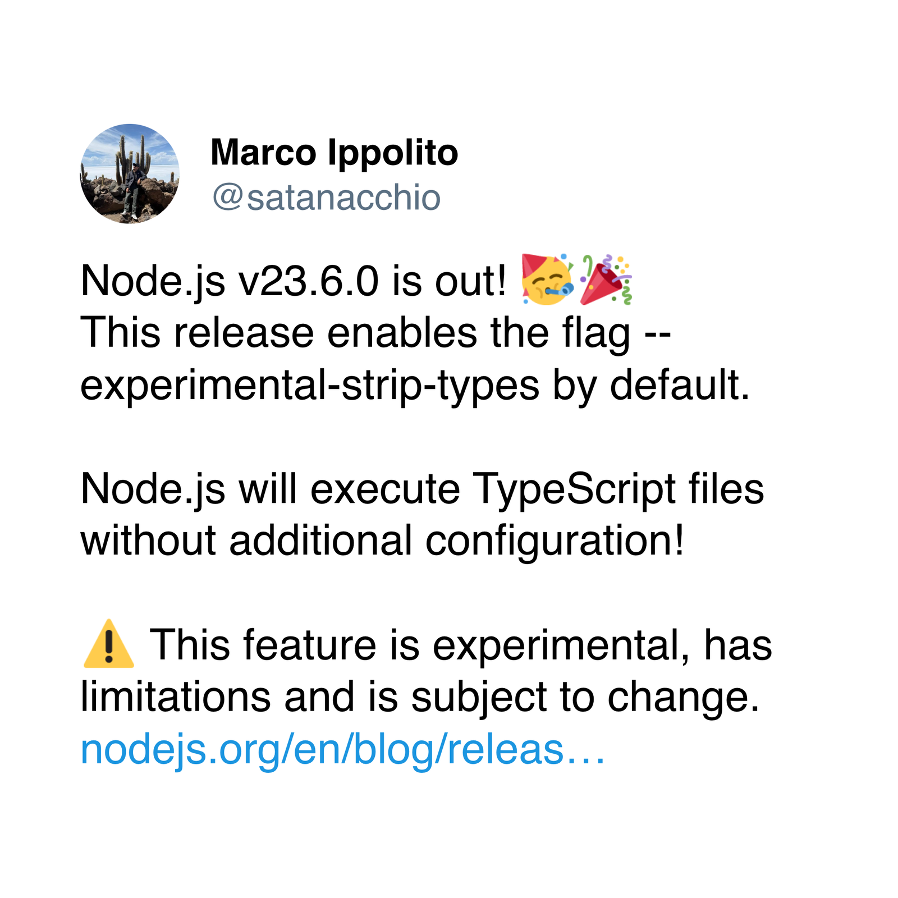

Node.js ekosystem mám rád. Celkově Javascript je můj druhý nejsilnější jazyk. Když něco nechci psát v PHP, tak sáhnu po JS. Když do toho započítám Typescript, tak bomba.

> Víte, že Node.js od verze 23.6+ podporuje nativně Typescript?
>
> [https://nodejs.org/api/typescript.html](https://nodejs.org/api/typescript.html)
>
> 

Na OSX se mi stala chyba, která se mi sem tam opakuje a vždycky zapomenu o co jde. V hlavních rolích je tu **SASS** a modul distutils.

SASS již na nových projektech nepoužívám, šel jsem do [Tailwindu](https://tailwindcss.com/) a tak nějak není cesty zpět.

> Znáte TailwindUI? Umí to dost šetřit čas.
>
> [https://tailwindui.com/](https://tailwindui.com/)
>
> 

Co s tím? Naštěstí stačí doinstalovat jeden balíček.

**OSX**

```shell
brew install python-setuptools
```

**Linux**

```shell
python3 -m pip install setuptools
```
