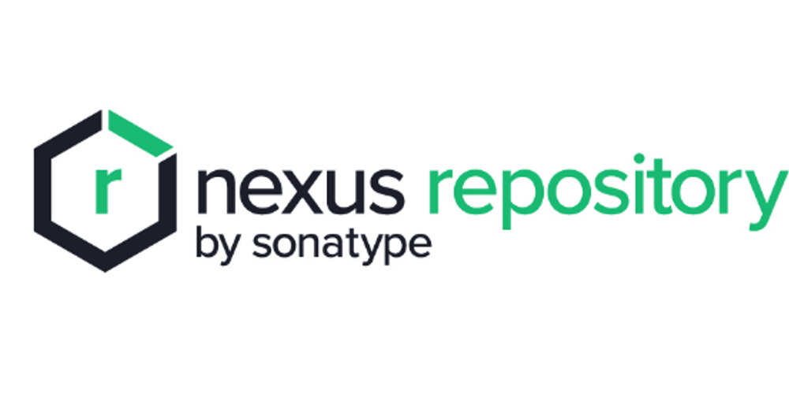
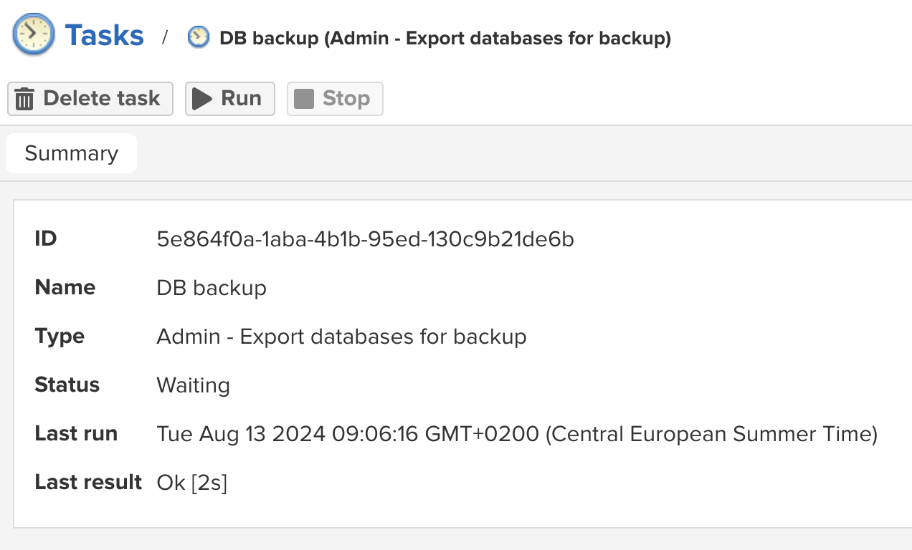
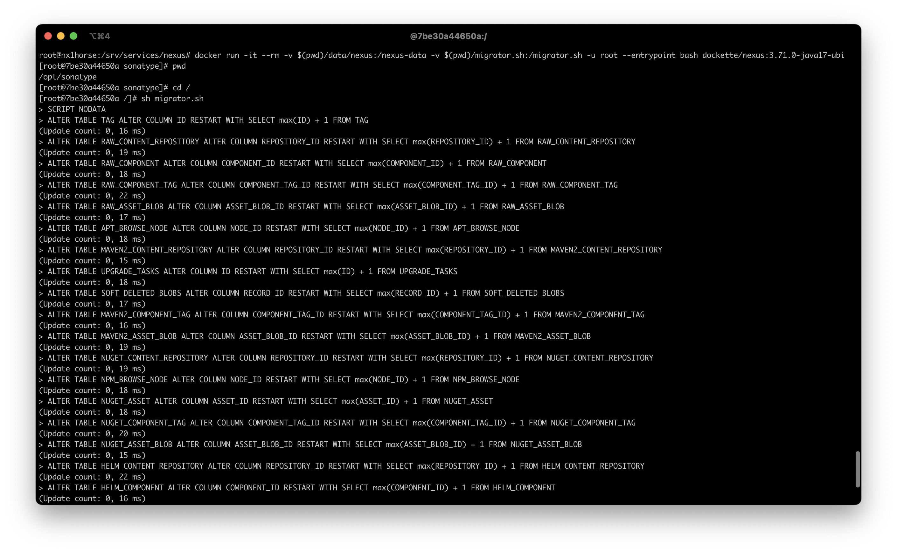

[Sonatype Nexus](https://www.sonatype.com/products/sonatype-nexus-repository) je univerzální uložiště pro APT, NPM, Docker a spoustu dalších balíčků. Funguje cloudově, dá se i selfhostovat.



Pokud hledáte privátní uložiště, doporučuje Nexus vyzkoušet. Pokud byste ho snad chtěli vykoušet provozovat v Dockeru, což osobně delám už zhruba 5 let, tak můžete vyzkoušet můj předpřipravný Docker image. Řeší pár specialit, jako třeba oprávnění, takže nemusíte nic řešit.

```shell
docker run \
	-it \
	--rm \
	-p 8081:8081 \
	-v $(pwd)/data:/nexus-data \
	dockette/nexus:3.71.0-java17-ubi
```

[https://github.com/dockette/nexus](https://github.com/dockette/nexus)

Od verze 3.71.0 došlo celkem k revoluci, kdy interně kompletně odstranili OrientDB a podporovaná databáze je pouze H2 a nebo Postgres. Postgres bohužel až v placené verzi.

Od Sonatype existuje celkem dobře popsaný migrační manuál. Kdo by přesto tápal jak to provést, hodím sem pár tipů.

## Zdroje

-   Migrační manuál → [https://help.sonatype.com/en/migrating-to-a-new-database.html](https://help.sonatype.com/en/migrating-to-a-new-database.html)
-   Migrátor → [https://help.sonatype.com/en/orientdb-downloads.html](https://help.sonatype.com/en/orientdb-downloads.html)
-   Issues → [https://github.com/sonatype/nexus-public/issues/451](https://github.com/sonatype/nexus-public/issues/451), [https://github.com/sonatype/nexus-public/issues/452](https://github.com/sonatype/nexus-public/issues/452), [https://github.com/sonatype/nexus-public/issues/449](https://github.com/sonatype/nexus-public/issues/449)

## Kroky

1.  Aktualizovat Nexus na poslední verzi 3.70.x.
2.  Provést manuální zálohu (Admin → Tasks → Admin - Export databases for backup).

1.  Nastavit **location** např. na `/nexus-data/db-backup`.



4.  Stopnout běžící Nexus (ale to je asi jasný, že jo).
5.  Stáhnout příslušný migrátor. Pozor na to, aby to byla verze 3.70.x.

1.  Stáhnout do složky, kde máte data a nebo `docker-compose.yml`.

```shell
sudo curl -L https://download.sonatype.com/nexus/nxrm3-migrator/nexus-db-migrator-3.70.1-03.jar -o nexus-db-migrator.jar
```

7.  Spustit Nexus s přepsaným entrypointem. Ať můžeme spustit migrátor.

1.  Spustíme docker kontejner.

```shell
docker run \
	-it \
	--rm \
	-v $(pwd)/data/nexus:/nexus-data \
	-u root \
	--entrypoint bash \
	dockette/nexus:3.71.0-java17-ubi
```

3.  Ve složce `/nexus-data/db-backup` , kde máme uložené zálohy z předchozího kroku, spustíme migrátor.

```shell
java \
	-Xmx16G \
	-Xms16G \
	-XX:+UseG1GC \
	-XX:MaxDirectMemorySize=28672M \ 
	-jar nexus-db-migrator.jar \ 
	--migration_type=h2
```

9.  Výstupní soubor `/nexus-data/db-backup/nexus.mv.db` přesuneme do `/nexus-data/db/nexus.mv.db` a nastavíme oprávnění `sudo chown 200:200 nexus.mv.db`.
10.  Upravíme `/nexus-data/etc/nexus.properties` soubor.

```text
nexus.datastore.enabled=true
```

12.  Et voilà, máme hotovo. Spustíme Sonatype Nexus standardním způsobem.

## Troubleshooting

Verze 3.71.x má aktuálně problém s autoincrementem v H2 databázi. Lze to jednoduše vyřešit přes script.

1.  Vytvořit `migrator.sh` script.

3.  Spustit Nexus s přepsaným entrypointem.

```shell
docker run \
	-it \
	--rm \
	-v $(pwd)/data/nexus:/nexus-data \
	-v $(pwd)/migrator.sh:/migrator.sh \
	-u root \
	--entrypoint bash \
	dockette/nexus:3.71.0-java17-ubi
```

Spustit `sh` `migrator.sh` a výstup bude zhruba následovný.



Doufám, že vám Nexus bude sloužit dobře. Dejte vědet.
