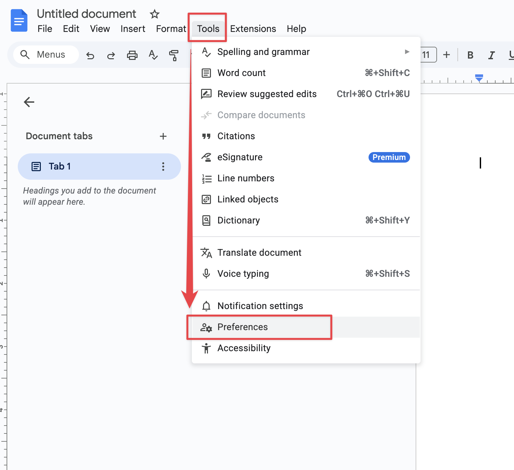
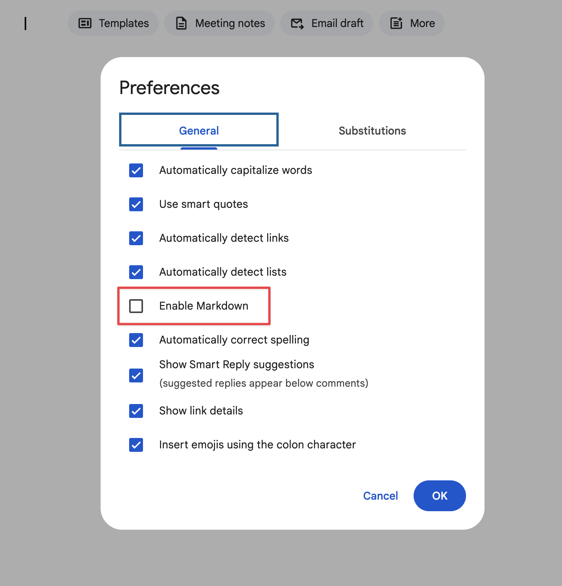
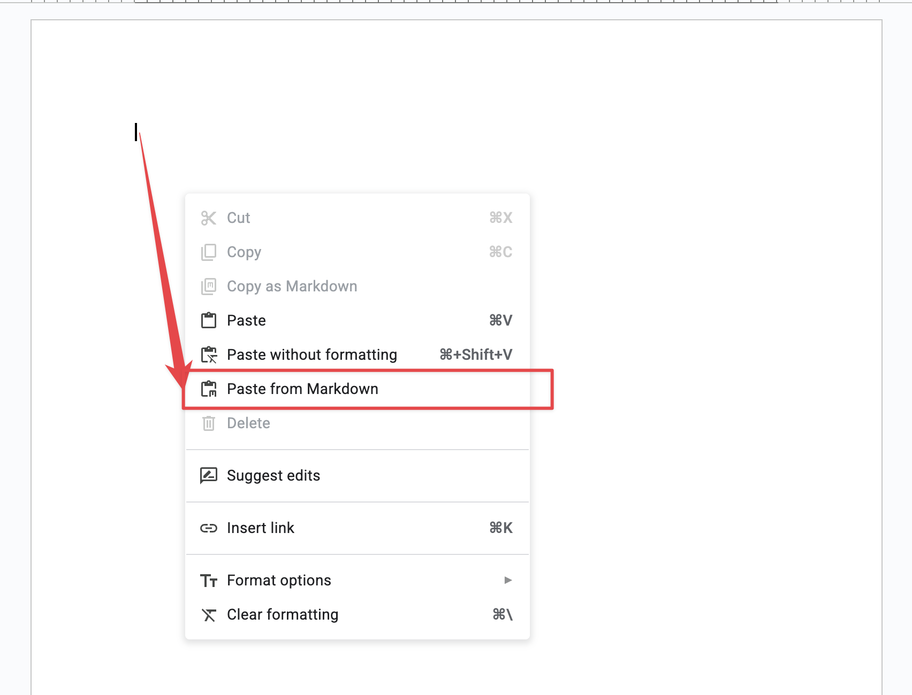

If you like writing in Markdown, Google Docs has you covered. You can turn on native Markdown support in just a few clicks.

**Here’s how:**

1.  Open your document in **Google Docs**
2.  Go to **Tools**
3.  Click **Preferences**
4.  Check **Enable** **Markdown**
5.  Click **OK**
6.  Right Click **Paste from Markdown**

That’s it 🎉

Now you can use Markdown syntax like `# Headings`, `**bold**`, `_italic_`, or lists or tables. Just use **Paste from Markdown** and enjoy.

