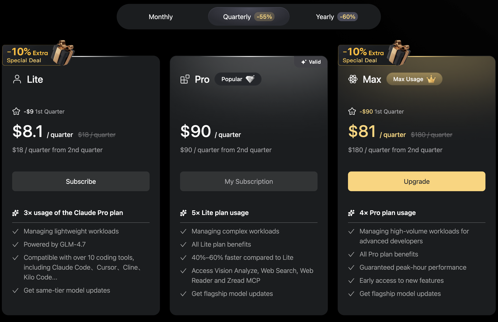

Combine [OpenCode.ai](https://opencode.ai/) with GitHub CLI to automate release tracking, generate reports, and query GitHub data through natural language prompts.

## Quick Setup

OpenCode is an open-source AI coding agent that executes commands and interacts with tools like GitHub CLI. Use the **[Z.AI](http://z.ai/)** **Coding Plan** provider with `glm-4.7` for coding-optimized results.



Run everything in Docker using [dockette/vibestack](https://github.com/dockette/vibestack):

```bash
PROMPT="Use Github CLI, already preconfigured, and list me last 5 releases \\
for github.com/contributte organization."

TOKEN="your_github_token"

docker run \
  -it \
  --rm \
  -v $(pwd):/workspace \
  -w /workspace \
  -e GH_TOKEN="${TOKEN}" \
  dockette/vibestack:latest \
  opencode run "${PROMPT}" 2>&1
```

Configure OpenCode in `opencode.json`:

# Github

Trigger OpenCode from issue comments using `/opencode` or `/oc`. See the [Contributte workflow](https://github.com/contributte/contributte/blob/master/.github/workflows/opencode.yml) for implementation.

Example prompt:

```text
/opencode Find me all releases for github.com/contributte repositories released in 2025/12.

Example format:

Releases 2025/12 (5x)
1. [contributte/api] - v1.2.3 <https://github.com/contributte/api/releases/tag/v1.2.3>
2. [contributte/forms] - v2.0.0 <https://github.com/contributte/forms/releases/tag/v2.0.0>
3. [contributte/console] - v1.0.0 <https://github.com/contributte/console/releases/tag/v1.0.0>
```

OpenCode will:

-   Query all repositories in the organization via GitHub CLI
-   Filter releases by date
-   Format output consistently
-   Include direct release links

See [issue #67](https://github.com/contributte/contributte/issues/67) for a real-world example.

# Output

As you can see there is tiny typo 26x releases, but so far so good.
